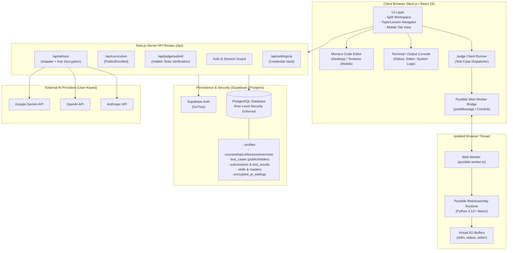

# CodeCoBUG — System Architecture Document

**Version**: 1.0.0  
**Date**: 2026-10-29  
**Status**: Approved Survey & Design Baseline (Phase 1)

---

## 1. System Overview

CodeCoBUG is an interactive Python learning and assessment platform combining a browser-based Python runtime (WebAssembly/Pyodide), an automated judging engine, persistent learner progression, and an AI-powered personal tutor.

The core design principle is **deterministic assessment first, AI augmentation second**. Code execution and grading must be repeatable, objective, and test-driven. AI acts as an adaptive mentor that analyzes actual execution artifacts, explains mental models, and provides graduated assistance without overriding deterministic test outcomes.



---

## 2. Component Boundaries & Responsibilities

### 2.1 Frontend & Workspace UI
- **Tech Stack**: Next.js (App Router), TypeScript, Vanilla CSS / Tailwind tokens, Lucide Icons.
- **Layout Architecture**:
  - **Desktop (>= 1024px)**: 3-pane adjustable split:
    - Left: Problem statement, examples, constraints, hints, requirements.
    - Right Top: Monaco Editor with Python syntax highlighting, autocompletion, auto-indent.
    - Right Bottom: Interactive Terminal & Test Execution Results drawer.
  - **Mobile (< 1024px)**: Tabbed interface (`[Đề bài]`, `[Code]`, `[Kết quả]`, `[AI Tutor]`).
- **SSR Safety**: Monaco Editor and Pyodide must load strictly dynamically (`next/dynamic` with `ssr: false`) to avoid server-side hydration mismatches or node runtime errors.

### 2.2 Python Execution Engine (Pyodide Worker)
- **Runtime**: WebAssembly Pyodide (`pyodide.js`).
- **Thread Isolation**: Executed strictly within a dedicated HTML5 Web Worker.
- **Execution Lifecycle**:
  1. **Lazy Loading**: Pyodide Wasm bundle (~10MB) is loaded on demand when the learner first navigates to an exercise workspace, cached via browser CacheStorage / IndexedDB.
  2. **Worker Reset / Clean State**: Execution runs in an isolated Python global dictionary (`pyodide.runPython(code, { globals: cleanGlobals })`). Builtins are preserved; imported modules or modified state are cleared between runs.
  3. **I/O Redirection**: Standard output (`sys.stdout`) and standard error (`sys.stderr`) are redirected to postMessage streams to deliver real-time terminal feedback.
  4. **Standard Input (`input()`)**:
     - *Batch Test Mode*: Provided as pre-filled input buffers piped into `sys.stdin`.
     - *Interactive Run Mode*: Handled via message request or `SharedArrayBuffer` + `Atomics.wait` (where cross-origin isolation headers `COOP/COEP` are active), or an async prompt fallback.
  5. **Watchdog / Timeout Handling**:
     - Execution watchdog timer defaults to 5,000ms.
     - If code enters an infinite loop (`while True:`), the main thread watchdog terminates the Web Worker immediately via `worker.terminate()`, displays `TimeLimitExceeded`, and instantiates a fresh worker pool.

### 2.3 Judge Engine
- **Grading Pipeline**:
  ```mermaid
  sequenceDiagram
      actor Learner
      participant UI as Exercise UI
      participant Worker as Pyodide Worker
      participant Server as Next.js API (/api/judge/submit)
      participant DB as Supabase DB

      Learner->>UI: Clicks "Nộp bài" (Submit)
      UI->>UI: Lock Editor & Set Pending Status
      UI->>Server: POST /api/judge/submit { exerciseId, code }
      Server->>DB: Fetch public + hidden test cases for exercise
      Server->>Server: Verify user rate limit & session
      Note over Server,UI: In WebAssembly judge mode:
      Server-->>UI: Authorize test run token (or run secure server evaluation)
      UI->>Worker: Run Test Case 1..N (Input_i -> Capture Actual_i)
      Worker-->>UI: Return Actual_i, ExitCode, Time, Error
      UI->>Server: POST execution report with checksum
      Server->>Server: Compare Actual vs Expected with Normalization
      Server->>DB: Insert Submissions & TestResults
      Server->>DB: Update SkillMastery & ReviewQueue
      Server-->>UI: Final Verdict (AC, WA, TLE, RE) + Test Breakdown
      UI->>Learner: Render Verdict Badge & Results Breakdown
  ```
- **Comparison Engine**:
  - `ExactMatch`: Strips trailing carriage returns (`\r\n` -> `\n`) and trailing whitespace per line.
  - `NormalizedLines`: Trims whitespace on both ends of each line.
  - `NumericTolerance`: Floats compared within $\epsilon = 10^{-6}$.
- **Security Invariant**: Expected outputs of **hidden tests** are never delivered to the client bundle ahead of execution.

### 2.4 Authentication & Persistence (Supabase)
- **Provider**: Supabase Auth (Email/Password, OAuth optional).
- **Session Management**: `@supabase/ssr` cookies with server-component auth guard.
- **Row Level Security (RLS)**:
  - `profiles`: SELECT public, UPDATE own profile.
  - `courses`, `topics`, `lessons`, `exercises`, `examples`: SELECT public/enrolled.
  - `test_cases`: Public tests visible to authenticated users; hidden test records have `expected_output` restricted to server-side service role only.
  - `submissions`, `test_results`: SELECT own, INSERT own.
  - `ai_settings`: SELECT/INSERT/UPDATE own, completely invisible to other users.

### 2.5 AI Tutor Engine & User API Key Vault
- **Key Strategy**: User-provided credentials (BYOK — Bring Your Own Key).
- **Security Architecture**:
  1. Client sends raw API key over HTTPS to `/api/settings/ai`.
  2. Server encrypts key using **AES-256-GCM** with a master `APP_ENCRYPTION_KEY` held exclusively in server environment variables.
  3. Server stores `encrypted_key`, `iv`, `auth_tag`, and `provider` in `ai_settings` table.
  4. Raw API key is **never** persisted in plaintext and **never** returned back in GET responses (only masked string e.g. `sk-...4a2f` is returned).
  5. During AI operations, server decrypts the key in-memory, executes the upstream provider call, and wipes key from scope.
- **Provider Adapter Architecture**:
  - Standard interface `AITutorProviderAdapter`:
    - `testConnection(credentials): Promise<boolean>`
    - `explainError(context: ErrorContext): Promise<string>`
    - `generateHint(context: HintContext): Promise<string>`
    - `analyzeTopicWeaknesses(history: SubmissionHistory[]): Promise<TopicReport>`
    - `generatePracticeExercise(prompt: string, criteria: SkillCriteria): Promise<ExerciseDraft>`
  - Implementations: `GoogleGeminiAdapter`, `OpenAIAdapter`, `AnthropicAdapter`.

---

## 3. Dependency & Interaction Map

| Component A | Component B | Interaction Mode | Failure Mode / Handling |
| :--- | :--- | :--- | :--- |
| **Workspace UI** | **Pyodide Worker** | Async Worker postMessage | Worker crash/timeout -> Main thread terminates worker, shows timeout alert, spawns replacement worker. |
| **Workspace UI** | **Next.js Backend** | REST / Fetch JSON | Network failure -> Retry queue, offline warning, local draft saved to IndexedDB/localStorage. |
| **Judge Engine** | **Pyodide Worker** | Batch test execution loop | Execution error captured as `RuntimeError` result, does not crash runner loop. |
| **Next.js Backend** | **Supabase DB** | PostgREST / Supabase JS Client | DB down / RLS rejection -> Return 403/500 with sanitized error; user alert displayed. |
| **AI Tutor API** | **External AI Provider** | HTTPS Fetch with decrypted key | Provider 429/401/500 -> Friendly Vietnamese error message ("API Key hết quota", "Key không hợp lệ"), does not affect judge verdict. |
| **Mastery Engine**| **Submissions Table** | DB Trigger / Server Post-Submit | Asynchronous calculation; judge response is not blocked if mastery calculation lags. |

---

## 4. Unsupported Scenarios & Architectural Boundaries

1. **Native OS System Calls**: Pyodide runs inside WebAssembly. Operations like `socket.bind`, `subprocess.Popen`, raw thread spawning, and direct filesystem root writes are restricted or mocked by Emscripten MEMFS.
2. **Third-Party C Extensions**: Only pure Python packages or wheels compiled for Pyodide/Emscripten can run. Heavy packages must be loaded via `micropip` only when explicitly specified.
3. **Multi-Tenant Server Execution**: User Python code runs strictly on the client browser. No untrusted user code executes on the Next.js server instance.
