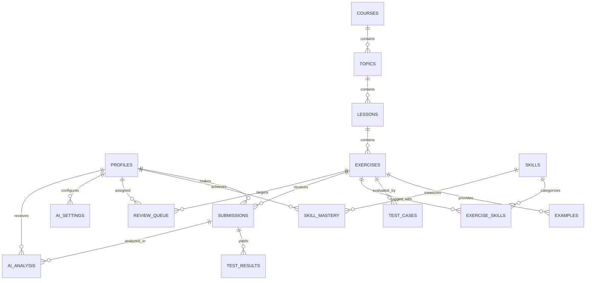

# CodeCoBUG — Database Schema & Data Model

**Version**: 1.0.0  
**Date**: 2026-10-29  
**Status**: Architecture Baseline (Phase 1)

---

## 1. Entity-Relationship Overview



---

## 2. Table Specifications

### 2.1 User Management & Profiles

#### `profiles`
Extends Supabase `auth.users` with application-specific learner state.
```sql
CREATE TABLE public.profiles (
    id UUID PRIMARY KEY REFERENCES auth.users(id) ON DELETE CASCADE,
    display_name TEXT NOT NULL,
    avatar_url TEXT,
    role TEXT NOT NULL DEFAULT 'learner' CHECK (role IN ('learner', 'instructor', 'admin')),
    created_at TIMESTAMPTZ NOT NULL DEFAULT timezone('utc'::text, now()),
    updated_at TIMESTAMPTZ NOT NULL DEFAULT timezone('utc'::text, now())
);
```

### 2.2 Curriculum Hierarchy

#### `courses`
Top-level learning curriculum container (e.g. "Lập trình Python từ cơ bản đến nâng cao").
```sql
CREATE TABLE public.courses (
    id UUID PRIMARY KEY DEFAULT gen_random_uuid(),
    slug TEXT NOT NULL UNIQUE,
    title TEXT NOT NULL,
    description TEXT,
    order_index INT NOT NULL DEFAULT 0,
    is_published BOOLEAN NOT NULL DEFAULT false,
    created_at TIMESTAMPTZ NOT NULL DEFAULT timezone('utc'::text, now())
);
```

#### `topics`
Major learning units (e.g. "Chủ đề 01: Làm quen Python", "Chủ đề 02: Biến & I/O").
```sql
CREATE TABLE public.topics (
    id UUID PRIMARY KEY DEFAULT gen_random_uuid(),
    course_id UUID NOT NULL REFERENCES public.courses(id) ON DELETE CASCADE,
    slug TEXT NOT NULL UNIQUE,
    title TEXT NOT NULL,
    summary TEXT,
    order_index INT NOT NULL DEFAULT 0,
    is_published BOOLEAN NOT NULL DEFAULT false,
    created_at TIMESTAMPTZ NOT NULL DEFAULT timezone('utc'::text, now())
);
CREATE INDEX idx_topics_course_order ON public.topics(course_id, order_index);
```

#### `lessons`
Individual theory sections inside a topic (e.g. "Phần A: Biến và quy tắc đặt tên").
```sql
CREATE TABLE public.lessons (
    id UUID PRIMARY KEY DEFAULT gen_random_uuid(),
    topic_id UUID NOT NULL REFERENCES public.topics(id) ON DELETE CASCADE,
    slug TEXT NOT NULL UNIQUE,
    title TEXT NOT NULL,
    theory_content TEXT,
    order_index INT NOT NULL DEFAULT 0,
    is_published BOOLEAN NOT NULL DEFAULT false,
    created_at TIMESTAMPTZ NOT NULL DEFAULT timezone('utc'::text, now())
);
CREATE INDEX idx_lessons_topic_order ON public.lessons(topic_id, order_index);
```

#### `exercises`
Coding problems associated with a lesson or topic.
```sql
CREATE TABLE public.exercises (
    id UUID PRIMARY KEY DEFAULT gen_random_uuid(),
    lesson_id UUID NOT NULL REFERENCES public.lessons(id) ON DELETE CASCADE,
    slug TEXT NOT NULL UNIQUE,
    title TEXT NOT NULL,
    description TEXT NOT NULL,
    starter_code TEXT DEFAULT '# Viết code của bạn ở đây\n',
    solution_code TEXT,
    difficulty TEXT NOT NULL CHECK (difficulty IN ('very_easy', 'easy', 'medium', 'hard', 'challenge')),
    points INT NOT NULL DEFAULT 10,
    completion_criteria JSONB NOT NULL DEFAULT '{"required_tests": "all", "forbidden_tokens": []}'::jsonb,
    order_index INT NOT NULL DEFAULT 0,
    is_published BOOLEAN NOT NULL DEFAULT false,
    created_at TIMESTAMPTZ NOT NULL DEFAULT timezone('utc'::text, now())
);
CREATE INDEX idx_exercises_lesson_order ON public.exercises(lesson_id, order_index);
```

#### `examples`
Public input/output examples shown directly in the exercise description (Minimum 3 scenarios).
```sql
CREATE TABLE public.examples (
    id UUID PRIMARY KEY DEFAULT gen_random_uuid(),
    exercise_id UUID NOT NULL REFERENCES public.exercises(id) ON DELETE CASCADE,
    input_data TEXT NOT NULL,
    expected_output TEXT NOT NULL,
    explanation TEXT,
    order_index INT NOT NULL DEFAULT 0
);
CREATE INDEX idx_examples_exercise ON public.examples(exercise_id, order_index);
```

#### `test_cases`
Authoritative test suites for Judge evaluation. Contains public and hidden test cases.
```sql
CREATE TABLE public.test_cases (
    id UUID PRIMARY KEY DEFAULT gen_random_uuid(),
    exercise_id UUID NOT NULL REFERENCES public.exercises(id) ON DELETE CASCADE,
    input_data TEXT NOT NULL,
    expected_output TEXT NOT NULL,
    is_hidden BOOLEAN NOT NULL DEFAULT false,
    comparison_mode TEXT NOT NULL DEFAULT 'exact' CHECK (comparison_mode IN ('exact', 'normalized_lines', 'regex', 'float_tolerance')),
    weight INT NOT NULL DEFAULT 1,
    order_index INT NOT NULL DEFAULT 0
);
CREATE INDEX idx_test_cases_exercise ON public.test_cases(exercise_id, is_hidden);
```

---

### 2.3 Submissions & Assessment Results

#### `submissions`
Learner submission records.
```sql
CREATE TABLE public.submissions (
    id UUID PRIMARY KEY DEFAULT gen_random_uuid(),
    user_id UUID NOT NULL REFERENCES public.profiles(id) ON DELETE CASCADE,
    exercise_id UUID NOT NULL REFERENCES public.exercises(id) ON DELETE CASCADE,
    submitted_code TEXT NOT NULL,
    status TEXT NOT NULL CHECK (status IN ('pending', 'running', 'completed', 'error')),
    verdict TEXT NOT NULL CHECK (verdict IN ('accepted', 'wrong_answer', 'runtime_error', 'time_limit_exceeded', 'compile_error', 'evaluating')),
    passed_tests_count INT NOT NULL DEFAULT 0,
    total_tests_count INT NOT NULL DEFAULT 0,
    execution_time_ms INT,
    error_summary TEXT,
    created_at TIMESTAMPTZ NOT NULL DEFAULT timezone('utc'::text, now())
);
CREATE INDEX idx_submissions_user_exercise ON public.submissions(user_id, exercise_id, created_at DESC);
```

#### `test_results`
Itemized execution outcomes per test case for a given submission.
```sql
CREATE TABLE public.test_results (
    id UUID PRIMARY KEY DEFAULT gen_random_uuid(),
    submission_id UUID NOT NULL REFERENCES public.submissions(id) ON DELETE CASCADE,
    test_case_id UUID NOT NULL REFERENCES public.test_cases(id) ON DELETE CASCADE,
    is_passed BOOLEAN NOT NULL,
    actual_output TEXT,
    error_message TEXT,
    execution_time_ms INT,
    created_at TIMESTAMPTZ NOT NULL DEFAULT timezone('utc'::text, now())
);
CREATE INDEX idx_test_results_submission ON public.test_results(submission_id);
```

---

### 2.4 Skills, Mastery & Adaptive Review

#### `skills`
Knowledge taxonomy tags (e.g. `variables_assignment`, `type_casting_str_int`, `input_output_fstring`).
```sql
CREATE TABLE public.skills (
    id UUID PRIMARY KEY DEFAULT gen_random_uuid(),
    code TEXT NOT NULL UNIQUE,
    name TEXT NOT NULL,
    category TEXT NOT NULL,
    description TEXT
);
```

#### `exercise_skills`
Many-to-many relationship mapping exercises to target skills.
```sql
CREATE TABLE public.exercise_skills (
    exercise_id UUID NOT NULL REFERENCES public.exercises(id) ON DELETE CASCADE,
    skill_id UUID NOT NULL REFERENCES public.skills(id) ON DELETE CASCADE,
    weight INT NOT NULL DEFAULT 1,
    PRIMARY KEY (exercise_id, skill_id)
);
```

#### `skill_mastery`
Learner mastery levels per skill based on empirical submission history.
```sql
CREATE TABLE public.skill_mastery (
    id UUID PRIMARY KEY DEFAULT gen_random_uuid(),
    user_id UUID NOT NULL REFERENCES public.profiles(id) ON DELETE CASCADE,
    skill_id UUID NOT NULL REFERENCES public.skills(id) ON DELETE CASCADE,
    mastery_score INT NOT NULL DEFAULT 0 CHECK (mastery_score BETWEEN 0 AND 100),
    total_attempts INT NOT NULL DEFAULT 0,
    successful_attempts INT NOT NULL DEFAULT 0,
    consecutive_successes INT NOT NULL DEFAULT 0,
    last_practiced_at TIMESTAMPTZ NOT NULL DEFAULT timezone('utc'::text, now()),
    updated_at TIMESTAMPTZ NOT NULL DEFAULT timezone('utc'::text, now()),
    UNIQUE(user_id, skill_id)
);
CREATE INDEX idx_skill_mastery_user ON public.skill_mastery(user_id, mastery_score);
```

#### `review_queue`
Targeted review queue generated when submissions fail or mastery criteria decay over time.
```sql
CREATE TABLE public.review_queue (
    id UUID PRIMARY KEY DEFAULT gen_random_uuid(),
    user_id UUID NOT NULL REFERENCES public.profiles(id) ON DELETE CASCADE,
    exercise_id UUID NOT NULL REFERENCES public.exercises(id) ON DELETE CASCADE,
    reason TEXT NOT NULL CHECK (reason IN ('failed_submission', 'periodic_review', 'prerequisite_weakness')),
    priority INT NOT NULL DEFAULT 1,
    status TEXT NOT NULL DEFAULT 'pending' CHECK (status IN ('pending', 'completed', 'dismissed')),
    due_at TIMESTAMPTZ NOT NULL DEFAULT timezone('utc'::text, now()),
    created_at TIMESTAMPTZ NOT NULL DEFAULT timezone('utc'::text, now())
);
CREATE INDEX idx_review_queue_user_status ON public.review_queue(user_id, status, due_at);
```

---

### 2.5 AI Tutor Configuration & Logs

#### `ai_settings`
User-provided API credentials encrypted at rest.
```sql
CREATE TABLE public.ai_settings (
    id UUID PRIMARY KEY DEFAULT gen_random_uuid(),
    user_id UUID NOT NULL UNIQUE REFERENCES public.profiles(id) ON DELETE CASCADE,
    provider TEXT NOT NULL CHECK (provider IN ('gemini', 'openai', 'anthropic', 'custom')),
    encrypted_api_key TEXT NOT NULL,
    iv TEXT NOT NULL,
    auth_tag TEXT NOT NULL,
    model_name TEXT NOT NULL,
    is_active BOOLEAN NOT NULL DEFAULT true,
    created_at TIMESTAMPTZ NOT NULL DEFAULT timezone('utc'::text, now()),
    updated_at TIMESTAMPTZ NOT NULL DEFAULT timezone('utc'::text, now())
);
```

#### `ai_analysis`
Audit logs of AI tutor interactions, explanations, and generated exercises.
```sql
CREATE TABLE public.ai_analysis (
    id UUID PRIMARY KEY DEFAULT gen_random_uuid(),
    user_id UUID NOT NULL REFERENCES public.profiles(id) ON DELETE CASCADE,
    submission_id UUID REFERENCES public.submissions(id) ON DELETE SET NULL,
    analysis_type TEXT NOT NULL CHECK (analysis_type IN ('error_explanation', 'hint', 'weakness_report', 'practice_generation')),
    prompt_context JSONB NOT NULL,
    response_content TEXT NOT NULL,
    tokens_used INT,
    created_at TIMESTAMPTZ NOT NULL DEFAULT timezone('utc'::text, now())
);
CREATE INDEX idx_ai_analysis_user ON public.ai_analysis(user_id, analysis_type);
```

---

## 3. Row Level Security (RLS) Policies

All tables must have RLS explicitly enabled:
`ALTER TABLE <table_name> ENABLE ROW LEVEL SECURITY;`

| Table | Policy Name | Command | Expression / Rule |
| :--- | :--- | :--- | :--- |
| `profiles` | Users can view all profiles | `SELECT` | `true` |
| `profiles` | Users can update own profile | `UPDATE` | `auth.uid() = id` |
| `courses` | Anyone can view published courses | `SELECT` | `is_published = true` |
| `topics` | Anyone can view published topics | `SELECT` | `is_published = true` |
| `lessons` | Anyone can view published lessons | `SELECT` | `is_published = true` |
| `exercises` | Anyone can view published exercises | `SELECT` | `is_published = true` |
| `examples` | Anyone can view examples of published exercises | `SELECT` | `true` |
| `test_cases` | Users can view only public test cases | `SELECT` | `is_hidden = false` |
| `submissions` | Users can view own submissions | `SELECT` | `auth.uid() = user_id` |
| `submissions` | Users can insert own submissions | `INSERT` | `auth.uid() = user_id` |
| `test_results` | Users can view results for own submissions | `SELECT` | `EXISTS (SELECT 1 FROM submissions s WHERE s.id = submission_id AND s.user_id = auth.uid())` |
| `skill_mastery` | Users can view own mastery | `SELECT` | `auth.uid() = user_id` |
| `review_queue` | Users can view & update own queue | `ALL` | `auth.uid() = user_id` |
| `ai_settings` | Users can view/manage own AI credentials | `ALL` | `auth.uid() = user_id` |
| `ai_analysis` | Users can view own AI analyses | `SELECT` | `auth.uid() = user_id` |

> [!CRITICAL]
> `test_cases.is_hidden = true` rows are **NEVER** accessible to standard client queries. The Judge Engine API uses the Supabase `service_role` key on the server side to fetch hidden tests, compare outputs, and return only the boolean pass/fail status and execution metrics without ever revealing the hidden inputs or expected outputs to the client.
