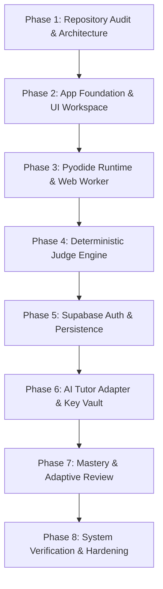

# CodeCoBUG — Implementation Plan & Phase Roadmaps

**Version**: 1.0.0  
**Date**: 2026-10-29  
**Status**: Architecture Baseline (Phase 1 Approved)

---

## 1. Overview & Phased Roadmap

This plan translates the directives of `AGENT.md` into an ordered, non-destructive, test-verified implementation pipeline.

---

## 2. Detailed Phase Specifications

### Phase 1 — Repository Audit & Architecture (CURRENT)
- **Goal**: Audit existing files, define architecture, map dependencies, specify data models, identify risks, and establish verification baselines.
- **Deliverables**:
  - `docs/CODECOBUG_ARCHITECTURE.md`
  - `docs/CODECOBUG_DATA_MODEL.md`
  - `docs/CODECOBUG_IMPLEMENTATION_PLAN.md`
  - `docs/CODECOBUG_TEST_PLAN.md`
  - Updated status in `AGENT.md`
- **Acceptance Criteria**:
  - [x] Full audit of existing workspace executed and verified.
  - [x] Architecture, data model, test plan, and implementation roadmap documented.
  - [x] Dependency mapping between UI, Pyodide, Judge, DB, Auth, and AI Tutor established.
  - [x] Zero real curriculum hardcoded or invented.
  - [x] Zero destructive operations performed.

---

### Phase 2 — Application Foundation & UI Workspace
- **Goal**: Initialize clean Next.js 15+ (App Router, TypeScript) framework, styling system, navigation, topic list views, and the responsive 3-pane exercise workspace.
- **Files to Create/Modify**:
  - `package.json`, `tsconfig.json`, `next.config.ts`, `tailwind.config.ts` (or CSS token system)
  - `app/layout.tsx`, `app/page.tsx` (Dashboard/Home)
  - `app/courses/[courseSlug]/page.tsx`, `app/topics/[topicSlug]/page.tsx`
  - `app/exercises/[exerciseSlug]/page.tsx` (Workspace entry)
  - `components/workspace/ExerciseWorkspace.tsx` (Split layout container)
  - `components/workspace/ProblemStatement.tsx` (Left pane: requirements, 3 examples)
  - `components/workspace/CodeEditor.tsx` (Monaco wrapper with dynamic SSR: false)
  - `components/workspace/TerminalOutput.tsx` (Console, stdout, stderr, execution status)
  - `components/common/Header.tsx`, `components/common/Navigation.tsx`
- **Key Dependencies**: React 19, Next.js 15, Lucide React, Monaco Editor (`@monaco-editor/react`).
- **Acceptance Criteria**:
  - [ ] Next.js app builds cleanly (`npm run build`) without TypeScript or lint errors.
  - [ ] Desktop layout displays 3 panes (Problem Statement, Code Editor, Terminal/Output).
  - [ ] Mobile viewport (< 1024px) stacks into tabs or vertical layout with full usability.
  - [ ] Problem statement renders requirements and at least 3 distinct example scenarios.
  - [ ] Empty states and loading skeletons are functional.
  - [ ] No fake execution or hardcoded "success" mockups.

---

### Phase 3 — Pyodide Runtime & Web Worker
- **Goal**: Implement in-browser WebAssembly Python execution isolated inside a Web Worker with streaming stdout/stderr, batch stdin, and execution watchdog.
- **Files to Create/Modify**:
  - `public/pyodide/` or CDN loading strategy with IndexedDB caching
  - `lib/pyodide/pyodide.worker.ts` (Worker script handling messages, runPython, stream redirection)
  - `lib/pyodide/PyodideClient.ts` (Main thread client manager, worker lifecycle, promise-based dispatch)
  - `lib/pyodide/types.ts` (ExecutionRequest, ExecutionResponse, StreamEvent)
  - `hooks/usePyodide.ts` (React hook exposing `runCode`, `isRunning`, `isReady`, `output`, `reset`)
- **Key Dependencies**: `pyodide` package / pyodide npm bundle.
- **Acceptance Criteria**:
  - [ ] Pyodide loads asynchronously without freezing the UI thread.
  - [ ] Basic Python execution (`print("Hello CodeCoBUG")`) writes to the terminal output.
  - [ ] Input-dependent code (`x = input(); print(f"Val: {x}")`) handles input data correctly.
  - [ ] Syntax errors (`print("missing parenthesis`) and runtime exceptions (`ZeroDivisionError`) are formatted cleanly and displayed.
  - [ ] Infinite loops (e.g. `while True: pass`) are terminated by watchdog within 5 seconds without crashing the browser tab.
  - [ ] State is wiped cleanly between independent runs (variables from run 1 do not bleed into run 2).

---

### Phase 4 — Deterministic Judge Engine
- **Goal**: Create automated test runner evaluating student code against public and hidden test cases, returning granular verdicts.
- **Files to Create/Modify**:
  - `lib/judge/comparator.ts` (Exact, NormalizedLines, FloatTolerance comparators)
  - `lib/judge/runner.ts` (Test case runner orchestrating sequential test execution)
  - `lib/judge/types.ts` (TestCase, TestResult, Verdict: AC, WA, TLE, RE, CE)
  - `components/workspace/TestResultsView.tsx` (Visual breakdown: Test 1, Test 2, Test 3...)
  - `app/api/judge/run-test/route.ts` (Public test verification)
  - `app/api/judge/submit/route.ts` (Full submission evaluation with hidden tests)
- **Key Dependencies**: PyodideClient, Comparator.
- **Acceptance Criteria**:
  - [ ] Clear distinction between "Run Code" (single execution with custom/sample input) and "Submit" (evaluates all test cases).
  - [ ] Each exercise supports at least 3 public test scenarios plus hidden test scenarios.
  - [ ] Hidden tests are never exposed in client bundles or network payloads.
  - [ ] Output comparison correctly handles line endings (`\r\n` vs `\n`) and trailing whitespace.
  - [ ] Accurate verdicts: AC on all tests passed; WA on wrong output; RE on exception; TLE on timeout.
  - [ ] Failing even 1 test case prevents completion state.

---

### Phase 5 — Authentication & Persistence (Supabase)
- **Goal**: Integrate Supabase Auth, apply database migrations, enforce RLS policies, and persist submissions, progress, and user preferences.
- **Files to Create/Modify**:
  - `supabase/migrations/001_initial_schema.sql` (Tables from Data Model)
  - `supabase/migrations/002_rls_policies.sql` (Security rules)
  - `lib/supabase/client.ts` (Browser Supabase client)
  - `lib/supabase/server.ts` (Server Component / Route Handler client)
  - `app/(auth)/login/page.tsx`, `app/(auth)/register/page.tsx`
  - `hooks/useAuth.ts`, `middleware.ts` (Protected route guard)
  - `app/api/submissions/route.ts` (Fetch submission history)
- **Key Dependencies**: `@supabase/supabase-js`, `@supabase/ssr`.
- **Acceptance Criteria**:
  - [ ] User sign-up, sign-in, and sign-out function properly with persistent session cookies.
  - [ ] Submissions and test results are saved to PostgreSQL with user ID attribution.
  - [ ] RLS policies prevent users from viewing other users' private submissions or AI credentials.
  - [ ] Hidden test expected outputs are inaccessible to client queries.
  - [ ] Page reload preserves user authentication state and code draft.

---

### Phase 6 — AI Tutor Adapter & Key Vault
- **Goal**: Implement user-provided API key encryption/storage, provider-independent adapter, and AI mentoring features (error explanation, hints, natural-language practice).
- **Files to Create/Modify**:
  - `lib/security/encryption.ts` (AES-256-GCM encrypt/decrypt with server master key)
  - `lib/ai/adapters/AIAdapter.ts` (Abstract base interface)
  - `lib/ai/adapters/GeminiAdapter.ts` (Google Gemini 1.5/2.0 API)
  - `lib/ai/adapters/OpenAIAdapter.ts` (OpenAI GPT-4o / GPT-4o-mini)
  - `lib/ai/factory.ts` (Instantiates adapter based on user configuration)
  - `app/api/settings/ai/route.ts` (Save, test connection, remove credentials)
  - `app/api/ai/explain/route.ts`, `app/api/ai/hint/route.ts`
  - `components/workspace/AITutorPanel.tsx` (AI mentor drawer with explanation and hints)
  - `components/settings/AISettingsModal.tsx` (BYOK configuration modal)
- **Key Dependencies**: Node.js `crypto` module, `@google/genai` or standard fetch.
- **Acceptance Criteria**:
  - [ ] API keys are encrypted at rest; plaintext key is never returned in client responses.
  - [ ] "Test Connection" button validates user API key before saving.
  - [ ] AI receives minimum necessary context (exercise prompt, user code, error message, failed test report).
  - [ ] AI explanation is formatted in friendly Vietnamese, prioritizing conceptual hints over full answers.
  - [ ] AI explanation cannot override a failed Judge verdict.
  - [ ] Quota exceeded (HTTP 429) and invalid key (HTTP 401) errors display informative guidance.

---

### Phase 7 — Mastery & Adaptive Review
- **Goal**: Implement error classification, skill proficiency tracking, review queue generation, and topic learning reports.
- **Files to Create/Modify**:
  - `lib/mastery/classifier.ts` (Error category mapping: Syntax, Type, Logic, Formatting)
  - `lib/mastery/calculator.ts` (Exponential decay / proficiency algorithm)
  - `app/api/mastery/route.ts`, `app/api/review/route.ts`
  - `components/dashboard/MasteryReport.tsx` (Topic breakdown: 90% Assignment, 60% Type casting...)
  - `components/dashboard/ReviewQueueCard.tsx` (Adaptive practice recommendation)
  - `app/reports/[topicSlug]/page.tsx` (Detailed topic competence report)
- **Acceptance Criteria**:
  - [ ] Submissions update `skill_mastery` and track recurring error categories.
  - [ ] Exercises with failed attempts are enqueued into the `review_queue`.
  - [ ] Topic reports display empirical mastery percentages and actionable study advice.
  - [ ] Review system generates variations or suggests target exercises based on diagnosed weaknesses.

---

### Phase 8 — System Verification, Hardening & Final Audit
- **Goal**: Run end-to-end user journeys, perform security audits, optimize loading speeds, verify mobile usability, and finalize production documentation.
- **Deliverables**:
  - Automated test suite execution (Vitest / Playwright)
  - Cross-browser and mobile verification report
  - Security audit confirming zero credential or hidden test leakage
  - Production deployment runbook
- **Acceptance Criteria**:
  - [ ] Full learner flow passes: Register -> Topic View -> Solve Exercise -> Pass Tests -> See Mastery.
  - [ ] Zero critical vulnerabilities (XSS, credential leakage, sandbox escape).
  - [ ] Mobile responsive layout operates smoothly without overlapping elements.
  - [ ] All environment variables documented in `.env.example`.
