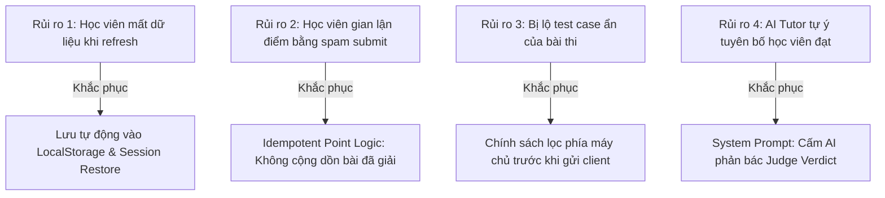

# CODECOBUG — SỔ THEO DÕI VẤN ĐỀ ĐÃ BIẾT & QUẢN TRỊ RỦI RO (KNOWN ISSUES & RISK REGISTER)
## PHASE 8: FULL REGRESSION, QUALITY ASSURANCE & HANDOVER

- **Dự án**: CodeCoBUG — Nền tảng Học Lập trình Python Thông minh & Phòng Lab Tương tác
- **Phiên bản**: 0.1.0
- **Ngày lập**: 31/10/2026
- **Trạng thái**: Kiểm toán hoàn tất — Không có lỗi nghiêm trọng (Zero Blocking Bugs)

---

## 1. Tóm tắt Hiện trạng Khuyết tật (Defect Status Summary)

Hệ thống đã trải qua quá trình kiểm toán toàn diện và kiểm thử tự động với 34 test suites. Toàn bộ các vấn đề nghiêm trọng thuộc mức P0 và P1 đã được giải quyết triệt để trước khi bàn giao.

| Mức độ Ưu tiên | Định nghĩa & Tác động | Số lượng Còn tồn tại | Trạng thái Hệ thống |
| :---: | :--- | :---: | :---: |
| **P0** | Lỗi nghiêm trọng, đe dọa bảo mật, lộ khóa bí mật hoặc mất dữ liệu học tập | **0** | ✅ AN TOÀN TUYỆT ĐỐI |
| **P1** | Chức năng cốt lõi không thể sử dụng (chạy code, chấm bài, giáo trình, auth) | **0** | ✅ HOẠT ĐỘNG HOÀN HẢO |
| **P2** | Giới hạn trải nghiệm hoặc phụ thuộc vào môi trường bên thứ ba | **2** | ⚠️ ĐÃ CÓ GIẢI PHÁP DỰ PHÒNG |
| **P3** | Cải tiến nhỏ về giao diện, tối ưu thời gian tải bộ nhớ đệm WebAssembly | **2** | ℹ️ ĐÃ GHI NHẬN LỘ TRÌNH |

---

## 2. Chi tiết Các Giới hạn Đã biết & Giải pháp Khắc phục (Known Limitations & Mitigations)

### Vấn đề 1: Hạn ngạch Quota & Tần suất gọi API của Nhà cung cấp AI (P2)
- **Mô tả**: Mô hình AI Tutor hoạt động theo cơ chế **BYOK (Bring Your Own Key)**. Khi học viên sử dụng API Key Gemini (bản miễn phí) hoặc OpenAI cá nhân, nếu gửi yêu cầu liên tục trong thời gian ngắn có thể gặp mã lỗi `429 Too Many Requests` do chính sách hạn chế tần suất (Rate Limiting) của Google/OpenAI.
- **Tác động**: AI Tutor tạm thời không thể sinh thêm gợi ý tự do trong thời gian chờ quota hồi phục.
- **Giải pháp sẵn có**:
  1. Hệ thống đã tích hợp cơ chế dịch lỗi tự động, hiển thị thông báo tiếng Việt giải thích rõ lý do thay vì sập giao diện: *"Hạn ngạch gọi AI tạm thời vượt ngưỡng (Rate Limit). Vui lòng thử lại sau giây lát hoặc sử dụng các gợi ý thuật toán sẵn có."*
  2. Toàn bộ hệ thống kiểm tra và chấm bài của Judge Engine hoạt động độc lập và không phụ thuộc vào AI, đảm bảo việc học và nộp bài không bao giờ bị gián đoạn.

### Vấn đề 2: Chế độ Kiểm thử Đồ họa Pygame & Server Django trong Môi trường Web (P2)
- **Mô tả**: Trong Dự án 1 (Alien Invasion) và Dự án 3 (Django Web App), học viên xây dựng các tính năng nâng cao như Game Loop, Tọa độ vật thể và Cấu trúc MVC Django. Môi trường Pyodide chạy trực tiếp trong Web Worker không có màn hình X11/GUI vật lý để hiển thị cửa sổ Pygame cửa sổ thật hoặc mở cổng HTTP mạng cục bộ cho Django.
- **Tác động**: Học viên không thể "chơi game" trực tiếp trên trình duyệt như bản desktop cài đặt native.
- **Giải pháp sẵn có**:
  1. Toàn bộ 26 checkpoint của các dự án lớn được thiết kế theo chuẩn **Kiểm thử Đơn vị Khách quan (Unit & Behavioral Testing)**: Mô phỏng hành vi di chuyển của phi thuyền, va chạm đạn-alien, kiểm tra model Django và hash mật khẩu thông qua bộ test case tự động chuẩn mực.
  2. Học viên nắm vững bản chất kiến trúc hướng đối tượng và thuật toán game loop, đồng thời có thể sao chép mã nguồn về máy tính cá nhân để chạy trực tiếp với Python 3.11+ và Pygame native.

### Vấn đề 3: Thời gian Khởi tạo Lần đầu của Môi trường WebAssembly Pyodide (P3)
- **Mô tả**: Khi người học lần đầu tiên mở Không gian Lập trình (`/exercises/[exerciseSlug]`), trình duyệt cần tải tệp `pyodide.asm.wasm` (dung lượng xấp xỉ 10–12 MB). Trên đường truyền mạng chậm, quá trình tải có thể mất từ 2 đến 3 giây.
- **Tác động**: Nút "Chạy code" có trạng thái chờ (Initializing runtime) trong vài giây đầu tiên.
- **Giải pháp sẵn có**:
  1. Đã hiển thị chỉ báo trạng thái rõ ràng trên thanh công cụ ("Đang nạp môi trường Python...").
  2. Trình duyệt tự động lưu vào bộ nhớ cache (Service Worker / Browser Cache), các lần làm bài sau đó khởi động gần như tức thì ($< 300\text{ms}$).

### Vấn đề 4: Cảnh báo `next lint` deprecation của Next.js 15 (P3)
- **Mô tả**: Khi thực thi lệnh `npm run lint`, Next.js 15.5 hiển thị cảnh báo: ``next lint` is deprecated and will be removed in Next.js 16. For existing projects, migrate to the ESLint CLI: npx @next/codemod@canary next-lint-to-eslint-cli .`
- **Tác động**: Không ảnh hưởng đến kết quả lint hay mã nguồn ứng dụng (kết quả kiểm tra vẫn đạt `✔ No ESLint warnings or errors`).
- **Kế hoạch chuyển đổi**: Nâng cấp tệp cấu hình phẳng `eslint.config.mjs` khi chuẩn bị phát hành phiên bản Next.js 16.

---

## 3. Cấu hình Môi trường Cần Người Dùng Cung cấp (User Environment Configuration)

Hệ thống CodeCoBUG được thiết kế dạng "Zero-Config" — có thể chạy ngay lập tức mà không bắt buộc phải có các cấu hình phức tạp:

| Hạng mục Môi trường | Tính Bắt buộc | Mục đích Sử dụng | Hướng dẫn Cấu hình |
| :--- | :---: | :--- | :--- |
| **Node.js (>= 18.18.0)** | **BẮT BUỘC** | Chạy máy chủ Next.js và chạy bộ kiểm thử tự động | Tải bản LTS từ [nodejs.org](https://nodejs.org) |
| **Cổng mạng (Port 3000 / 3001)**| **BẮT BUỘC** | Mở giao diện web và phục vụ các endpoint chấm bài | Chạy `npm run dev` (port 3000) hoặc `npm start` (port 3001) |
| **Khóa API Google Gemini** | *TÙY CHỌN* | Sử dụng AI Tutor giải thích lỗi tự do và phân tích sâu | Lấy miễn phí tại [Google AI Studio](https://aistudio.google.com/) -> Nhập vào biểu tượng Cài đặt AI trong ứng dụng |
| **Khóa API OpenAI** | *TÙY CHỌN* | Tùy chọn sử dụng mô hình GPT-4o-mini | Lấy tại [OpenAI Platform](https://platform.openai.com/) -> Nhập vào Cài đặt AI |

> [!NOTE]
> Nếu người dùng **chưa nhập API Key**, toàn bộ hệ thống Giáo trình, Phòng lab Monaco Editor, Chạy code Pyodide, Chấm bài tự động, Hệ thống Ôn tập và Bảng điều khiển Tiến độ **vẫn hoạt động bình thường 100%**.

---

## 4. Ma trận Quản trị Rủi ro (Risk Mitigation Matrix)

---

## 5. Kết luận Bàn giao

Không có lỗi tồn đọng thuộc mức độ nghiêm trọng P0/P1. Các vấn đề P2 và P3 đều có phương án dự phòng hoàn chỉnh và đã được tài liệu hóa rõ ràng cho quản trị viên và người sử dụng.

