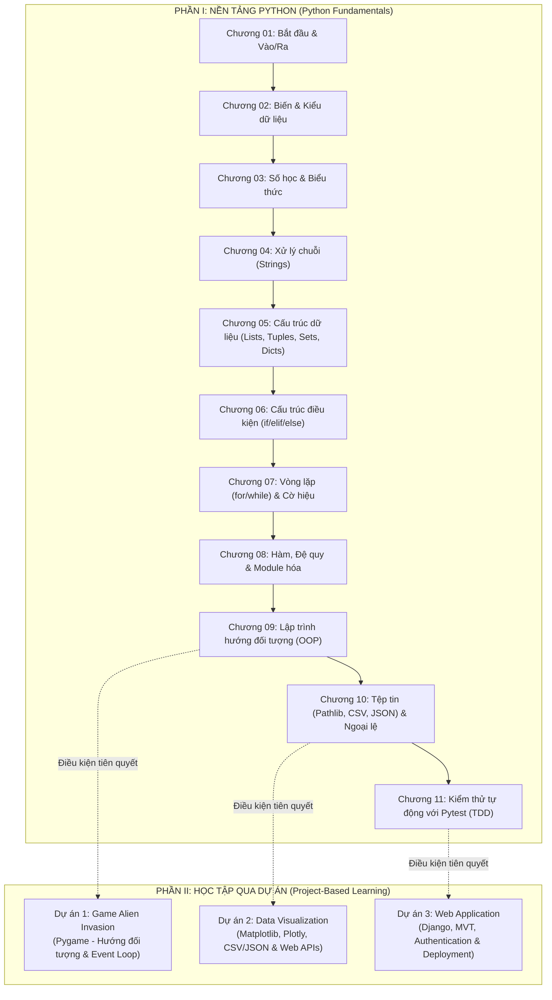

# BẢN ĐỒ HỢP NHẤT GIÁO TRÌNH PYTHON: PCC 3E, W3SCHOOLS VÀ CODECOBUG

*Tài liệu định vị, đối chiếu và xây dựng kiến trúc giáo trình Python thống nhất cho nền tảng CodeCoBUG.*  
*Ngày thực hiện: 30/10/2026 — Trạng thái: HOÀN THÀNH STEP 1 MAPPING*

---

## 1. NGUYÊN TẮC HỢP NHẤT GIÁO TRÌNH (UNIFIED CURRICULUM ARCHITECTURE)

Theo quy định bắt buộc trong mục **#5 UNIFIED PYTHON CURRICULUM** của `AGENT.md`:
1. **Duy nhất một giáo trình chuẩn (ONE Unified Curriculum)**: Tuyệt đối không tạo ra hai luồng học tập song song (một luồng theo W3Schools và một luồng theo Python Crash Course). Toàn bộ người học trên CodeCoBUG chỉ đi qua một lộ trình chuẩn mực thống nhất.
2. **Kết hợp thế mạnh của hai nguồn tài liệu**:
   - **W3Schools**: Cung cấp độ phủ toàn diện về mặt cú pháp chuẩn, tra cứu nhanh, các hàm có sẵn trong thư viện chuẩn (Built-in functions), Sets, Tuples, Lambda, RegEx, Math, Datetime.
   - **Python Crash Course 3E (PCC 3E)**: Cung cấp tính thực chiến, tư duy giải quyết vấn đề, chuẩn viết code PEP 8 hiện đại (Python 3.11+), kỹ thuật kiểm thử tự động với `pytest`, và 3 dự án lớn ở Phần II (Game, Trực quan hóa dữ liệu, Web App).
3. **Phân kỳ cấu trúc**:
   - **PHẦN I: NỀN TẢNG PYTHON (PYTHON FUNDAMENTALS)** — Gồm 11 Chương lý thuyết kết hợp bài tập thực hành thuật toán có chấm điểm tự động bằng Judge Engine.
   - **PHẦN II: HỌC TẬP QUA DỰ ÁN (PROJECT-BASED LEARNING)** — Gồm 3 Dự án thực chiến lớn, chia nhỏ thành các chặng kiểm tra (checkpoints) và bài tập logic thành phần.

---

## 2. BẢNG ĐỐI CHIẾU TỔNG THỂ (MASTER CURRICULUM MAPPING TABLE)

| PCC3E Chapter | Topic Title | Existing CodeCoBUG Topic | Action | Chi tiết hành động tích hợp & Làm giàu nội dung |
| :--- | :--- | :--- | :---: | :--- |
| **Chapter 1** | Getting Started | Chủ đề 01: Làm quen với Python & I/O | `Merge / Update` | Cập nhật hướng dẫn cài đặt Python 3.11+, giao diện VS Code, tích hợp sâu hơn triết lý Zen of Python (`import this`). |
| **Chapter 2** | Variables and Simple Data Types | Chủ đề 02: Biến và kiểu dữ liệu | `Merge / Update` | Bổ sung phương thức chuỗi mới `removeprefix()`, `removesuffix()`, kỹ thuật đặt tên biến theo chuẩn PEP 8 và đọc thông báo lỗi cải tiến của Python 3.11+. |
| **Chapter 3–4** | Lists & Working with Lists | Chủ đề 05: Cấu trúc dữ liệu (Lists) & Chủ đề 07 (Vòng lặp) | `Merge / Update` | Giữ nguyên độ sâu về Tuples & Sets của W3Schools; làm giàu kỹ năng thao tác List của PCC3E: `del`, `pop()`, `remove()`, `sort()`, `sorted()`, cắt lát `slice[:]` và `List Comprehension`. |
| **Chapter 5** | If Statements | Chủ đề 06: Cấu trúc điều kiện (if, elif, else) | `Merge / Update` | Làm giàu thêm các bài toán kiểm tra danh sách rỗng (`if my_list:`), kiểm tra phần tử với `in` / `not in`, kết hợp điều kiện phức hợp trong thực tế. |
| **Chapter 6** | Dictionaries | Chủ đề 05: Cấu trúc dữ liệu (Dictionary) | `Merge / Update` | Mở rộng kỹ thuật lồng dữ liệu nâng cao (Nesting): Danh sách trong từ điển, từ điển trong danh sách, từ điển lồng từ điển; phương thức an toàn `dict.get()`. |
| **Chapter 7** | Input and While Loops | Chủ đề 01 (input) & Chủ đề 07 (Vòng lặp while) | `Merge / Update` | Tích hợp kỹ thuật sử dụng cờ báo hiệu (Flag variable), kỹ thuật dùng vòng lặp `while` để di chuyển dữ liệu giữa các danh sách hoặc loại bỏ phần tử lặp. |
| **Chapter 8** | Functions | Chủ đề 08: Hàm trong Python (Functions) | `Merge / Update` | Bổ sung đối số tùy biến `*args` và `**kwargs`, truyền bản sao danh sách để chống đột biến dữ liệu ngoài ý muốn (`my_list[:]`), tổ chức hàm vào module. Giữ nguyên bài học Đệ quy và Lambda của CodeCoBUG. |
| **Chapter 9** | Classes | Chủ đề 11: Lập trình hướng đối tượng (OOP) | `Merge / Update` | Nâng cấp bài giảng Kế thừa (`super()`), kỹ thuật Composition (sử dụng đối tượng làm thuộc tính của đối tượng khác). Giữ nguyên bài học Dunder Methods (`__str__`, `__len__`, `__repr__`) của CodeCoBUG. |
| **Chapter 10** | Files and Exceptions | Chủ đề 10: Thao tác File & Chủ đề 09: Ngoại lệ | `Merge / Update` | Bổ sung module hiện đại `pathlib.Path` (`read_text()`, `write_text()`), kết hợp xử lý file JSON/CSV và kỹ thuật xử lý ngoại lệ `try-except-else-finally` thực chiến. |
| **Chapter 11** | Testing Your Code | *Chưa có (Mới hoàn toàn)* | `Add / Update` | **BỔ SUNG CHƯƠNG MỚI**: Hướng dẫn học viên tự viết Unit Test bằng thư viện `pytest`, mệnh đề `assert`, kiểm thử hàm, kiểm thử lớp và sử dụng Fixtures (`@pytest.fixture`). |
| **Chapters 12–14** | Alien Invasion (Pygame) | *Chưa có (Phần II - Dự án)* | `Project Module` | **DỰ ÁN 1**: Xây dựng Game bắn tàu ngoài hành tinh với Pygame (Cửa sổ game, vòng lặp game loop, điều khiển tàu bay, bắn đạn, hạm đội ngoài hành tinh, tính điểm và tăng cấp). |
| **Chapters 15–17** | Data Visualization | *Chưa có (Phần II - Dự án)* | `Project Module` | **DỰ ÁN 2**: Xử lý và Trực quan hóa dữ liệu (Vẽ biểu đồ với Matplotlib & Plotly Express, phân tích dữ liệu nhiệt độ CSV, bản đồ động đất GeoJSON, và kết nối REST API GitHub/Hacker News). |
| **Chapters 18–20** | Web Applications (Django) | *Chưa có (Phần II - Dự án)* | `Advanced Project` | **DỰ ÁN 3**: Phát triển Ứng dụng Web "Learning Log" bằng Django 4.1, tạo Models, migrations, Views, HTML Templates với Bootstrap 5, phân quyền người dùng và quy trình triển khai ứng dụng. |

---

## 3. PHÂN TÍCH CHI TIẾT THEO TỪNG CHƯƠNG (DEEP-DIVE CHAPTER ANALYSIS)

### Chương 01: Bắt đầu với Python (Getting Started)
- **Nội dung trong PCC 3E**: Cài đặt Python 3.11, làm quen với VS Code, chạy chương trình `hello_world.py`, giải thích cách Python thực thi mã nguồn.
- **Nội dung W3Schools tương ứng**: `Python Intro`, `Python Get Started`, `Python Syntax`.
- **Hiện trạng CodeCoBUG**: Chủ đề 01 đã có 4 bài học (Giới thiệu, Cú pháp & Comment, `print()`, `input()`) và 11 bài tập thực hành.
- **Phương án tích hợp**:
  - Hợp nhất: Giữ nguyên các bài tập về `print()` và `input()`.
  - Cập nhật: Bổ sung mục giới thiệu VS Code trong phần lý thuyết và triết lý lập trình Python (*The Zen of Python - PEP 20*).

---

### Chương 02: Biến và Các kiểu dữ liệu cơ bản (Variables and Simple Data Types)
- **Nội dung trong PCC 3E**: Biến, chuỗi ký tự (`title()`, `upper()`, `lower()`, f-strings, `strip()`, `removeprefix()`, `removesuffix()`), số nguyên, số thực, dấu gạch dưới trong số lớn (`1_000_000`), gán nhiều biến, hằng số (viết hoa), chú thích, cách đọc thông báo lỗi cải tiến trong Python 3.11+.
- **Nội dung W3Schools tương ứng**: `Python Variables`, `Python Data Types`, `Python Numbers`, `Python Casting`, `Python Strings`.
- **Hiện trạng CodeCoBUG**: Chủ đề 02 (Biến & Kiểu dữ liệu, 8 bài) và Chủ đề 04 (Xử lý chuỗi, 6 bài).
- **Phương án tích hợp**:
  - Bổ sung vào bài xử lý chuỗi 2 phương thức tiện ích cực hay trong Python 3.9+: `removeprefix()` và `removesuffix()`.
  - Bổ sung bài tập về hằng số và quy ước PEP 8.
  - Tích hợp hướng dẫn đọc thông báo lỗi cú pháp (Syntax Error Traceback) thân thiện.

---

### Chương 03–04: Danh sách & Làm việc với Danh sách (Lists & Working with Lists)
- **Nội dung trong PCC 3E**: Khái niệm List, truy cập phần tử, chỉ mục âm `-1`, thay đổi, thêm (`append`, `insert`), xóa (`del`, `pop`, `remove`), sắp xếp (`sort()`, `sorted()`), đảo ngược (`reverse()`), độ dài `len()`. Vòng lặp `for` duyệt list, hàm `range()`, các hàm thống kê (`min`, `max`, `sum`), biểu thức khởi tạo danh sách (*List Comprehensions*), cắt lát (*Slicing*), sao chép list, bộ dữ liệu Tuple.
- **Nội dung W3Schools tương ứng**: `Python Lists`, `Python Tuples`, `Python For Loops`.
- **Hiện trạng CodeCoBUG**: Chủ đề 05 (Cấu trúc dữ liệu, 5 bài) và Chủ đề 07 (Vòng lặp, 5 bài).
- **Phương án tích hợp**:
  - Hợp nhất toàn diện các thao tác trên List của PCC 3E vào Bài 01 và Bài 04 của Chủ đề 05.
  - **Giữ lại**: Bài giảng chi tiết về Tuple và Set của W3Schools (đặc biệt là các phép toán tập hợp toán học như giao, hợp, hiệu) vì đây là kiến thức nền tảng rất cần thiết cho thuật toán.

---

### Chương 05: Cấu trúc rẽ nhánh điều kiện (If Statements)
- **Nội dung trong PCC 3E**: Kiểm tra điều kiện (bằng, khác, so sánh số, toán tử `and`/`or`), kiểm tra giá trị tồn tại trong danh sách (`in`, `not in`), giá trị Boolean, câu lệnh `if`, `if-else`, chuỗi `if-elif-else`, bỏ qua `else`, kiểm tra nhiều điều kiện độc lập, sử dụng `if` với danh sách (xử lý danh sách rỗng, so sánh 2 danh sách).
- **Nội dung W3Schools tương ứng**: `Python If...Else`, `Python Booleans`, `Python Operators`.
- **Hiện trạng CodeCoBUG**: Chủ đề 06 (Cấu trúc điều kiện, 3 bài, 3 bài tập) và Chủ đề 03 (Toán tử so sánh & logic).
- **Phương án tích hợp**:
  - Bổ sung bài toán thực tế lấy cảm hứng từ PCC 3E: Bài toán kiểm tra nguyên liệu bánh Pizza (duyệt danh sách và kiểm tra điều kiện `if item in available_toppings`), kiểm tra tính hợp lệ của người dùng trong hệ sinh thái Teen.

---

### Chương 06: Từ điển tra cứu (Dictionaries)
- **Nội dung trong PCC 3E**: Cặp khóa - giá trị (Key-Value), truy xuất dữ liệu, thêm mới, sửa đổi, xóa (`del`), phương thức `get()` kèm giá trị mặc định tránh lỗi `KeyError`. Duyệt từ điển (`items()`, `keys()`, `values()`, `set(dict.values())`). Kỹ thuật lồng ghép (*Nesting*): danh sách từ điển (danh sách người dùng), danh sách trong từ điển (sở thích của một người), từ điển lồng từ điển.
- **Nội dung W3Schools tương ứng**: `Python Dictionaries`.
- **Hiện trạng CodeCoBUG**: Chủ đề 05 Bài 03 (Từ điển tra cứu, 1 bài tập).
- **Phương án tích hợp**:
  - Nâng cấp độ khó và số lượng bài tập của Từ điển: Tách thành 2 bài học chi tiết (Bài cơ bản: Khởi tạo, CRUD và phương thức `get()`; Bài nâng cao: Kỹ thuật Nesting lồng ghép dữ liệu phức tạp).

---

### Chương 07: Nhập dữ liệu & Vòng lặp While (User Input and While Loops)
- **Nội dung trong PCC 3E**: Hàm `input()`, ép kiểu số nguyên `int()`, toán tử chia lấy dư `%` kiểm tra chẵn lẻ. Vòng lặp `while`, điều kiện dừng, sử dụng biến cờ (*Flag*), lệnh `break` thoát vòng lặp, lệnh `continue` chuyển bước lặp, phòng chống vòng lặp vô tận. Sử dụng `while` với danh sách và từ điển: chuyển phần tử giữa 2 danh sách, xóa toàn bộ phần tử có giá trị cụ thể, nạp dữ liệu từ bàn phím vào từ điển.
- **Nội dung W3Schools tương ứng**: `Python While Loops`, `Python User Input`.
- **Hiện trạng CodeCoBUG**: Đang nằm phân tán tại Chủ đề 01 (input) và Chủ đề 07 (vòng lặp while).
- **Phương án tích hợp**:
  - Giữ bài học `input()` cơ bản ở Chủ đề 01 để học viên có thể giải các bài tập ngay từ đầu.
  - Bổ sung các kỹ thuật nâng cao của PCC 3E vào Chủ đề 07: Kỹ thuật cờ hiệu (Flag pattern) và kỹ thuật quản lý trạng thái luồng lặp khi xử lý danh sách.

---

### Chương 08: Hàm trong Python (Functions)
- **Nội dung trong PCC 3E**: Định nghĩa hàm `def`, truyền đối số, phân biệt đối số vị trí (*positional*) và đối số từ khóa (*keyword*), giá trị mặc định (*default value*), giá trị trả về `return`, trả về từ điển, kết hợp hàm với vòng lặp `while`, truyền danh sách vào hàm, bảo vệ danh sách gốc bằng cách truyền bản sao `[:]`, đối số biến thiên vô định `*args` và `**kwargs`, tổ chức hàm vào tệp module và các cú pháp `import`.
- **Nội dung W3Schools tương ứng**: `Python Functions`, `Python Scope`.
- **Hiện trạng CodeCoBUG**: Chủ đề 08 (4 bài: Hàm cơ bản, Tham số nâng cao, Phạm vi biến & Lambda, Đệ quy).
- **Phương án tích hợp**:
  - Hợp nhất xuất sắc: CodeCoBUG đã có sẵn `*args`, `**kwargs`, `lambda` và `recursion`.
  - Bổ sung bài tập thực hành về tính chất "Đột biến dữ liệu" (Mutable vs Immutable khi truyền List vào Function) và kỹ thuật module hóa.

---

### Chương 09: Lập trình hướng đối tượng (Classes & OOP)
- **Nội dung trong PCC 3E**: Tạo lớp `class`, phương thức khởi tạo `__init__`, biến `self`, tạo thực thể (instance), truy cập thuộc tính và phương thức, thiết lập giá trị mặc định, cập nhật thuộc tính trực tiếp hoặc qua phương thức, kế thừa (*Inheritance*), hàm `super()`, ghi đè phương thức lớp cha, kỹ thuật Composition (đối tượng làm thuộc tính của đối tượng khác), module hóa lớp (import một lớp, nhiều lớp, cả module), làm quen với thư viện chuẩn Python (lớp `Random` từ module `random`).
- **Nội dung W3Schools tương ứng**: `Python Classes/Objects`, `Python Inheritance`, `Python Polymorphism`.
- **Hiện trạng CodeCoBUG**: Chủ đề 11 (4 bài: Lớp & Đối tượng, Kế thừa, Dunder Methods, Đóng gói).
- **Phương án tích hợp**:
  - Bổ sung mô hình ví dụ kinh điển của PCC 3E (Lớp `Car` và lớp con `ElectricCar` kết hợp lớp `Battery` làm minh họa trực quan cho Composition).
  - Giữ lại phần Dunder Methods (`__str__`, `__len__`, `__add__`) của CodeCoBUG vì đây là kiến thức OOP cực kỳ quan trọng khi học viên tiếp cận thư viện nâng cao hoặc framework Django.

---

### Chương 10: Tệp tin và Ngoại lệ (Files and Exceptions)
- **Nội dung trong PCC 3E**: Đọc tệp tin với module `pathlib.Path`, phương thức `read_text()`, chia dòng bằng `splitlines()`, xử lý nội dung tệp lớn; ghi tệp với `write_text()`; Xử lý ngoại lệ với khối `try-except-else`, lỗi `ZeroDivisionError`, `FileNotFoundError`, từ khóa `pass` để bỏ qua lỗi trong im lặng; Lưu trữ dữ liệu có cấu trúc với module `json` (`json.dumps()`, `json.loads()`), kỹ thuật refactoring mã nguồn lưu trạng thái người dùng.
- **Nội dung W3Schools tương ứng**: `Python File Handling`, `Python Try...Except`, `Python JSON`.
- **Hiện trạng CodeCoBUG**: Chủ đề 09 (Xử lý lỗi với try/except/raise) và Chủ đề 10 (Thao tác File với `with open()`, JSON, CSV).
- **Phương án tích hợp**:
  - Đây là sự kết hợp hoàn hảo: Giữ nguyên `with open()` và xử lý CSV theo chuẩn W3Schools, đồng thời bổ sung module hướng đối tượng `pathlib.Path` hiện đại của PCC 3E.
  - Tích hợp bài toán "Ghi nhớ người dùng" (*Remember Me pattern*) bằng JSON file.

---

### Chương 11: Kiểm thử mã nguồn với Pytest (Testing Your Code)
- **Nội dung trong PCC 3E**: Tầm quan trọng của kiểm thử tự động, cài đặt thư viện `pytest`, viết hàm kiểm thử đầu tiên, câu lệnh khẳng định `assert`, ca kiểm thử thành công, ca kiểm thử thất bại, phản ứng đúng đắn khi test hỏng, bổ sung ca kiểm thử mới; Kiểm thử một lớp đối tượng (Testing a Class), sử dụng Fixtures với decorator `@pytest.fixture` để chuẩn bị dữ liệu kiểm thử tái sử dụng.
- **Nội dung W3Schools tương ứng**: Không có (W3Schools chỉ tập trung vào cú pháp cơ bản).
- **Hiện trạng CodeCoBUG**: Chưa có bài giảng dạy học viên tự viết Unit Test (mới chỉ có Judge Engine chấm bài của học viên).
- **Phương án tích hợp**:
  - **BỔ SUNG THÀNH CHỦ ĐỀ CHÍNH THỨC**: Thêm học phần "Kiểm thử tự động & Tư duy TDD với pytest".
  - Giúp học viên chuyển đổi từ tư duy "chạy thử bằng mắt trong terminal" sang tư duy của kỹ sư phần mềm chuyên nghiệp: "Viết test tự động trước và sau khi refactor mã nguồn".

---

### Chương 12–14: Dự án 1 — Trò chơi Alien Invasion (Pygame)
- **Nội dung trong PCC 3E**: Xây dựng game 2D hoàn chỉnh: Tạo cửa sổ game với Pygame, đối tượng tàu bay di chuyển mượt theo bàn phím, bắn tia laser, xây dựng hạm đội quái vật ngoài hành tinh di chuyển theo lưới và đổi hướng khi chạm tường, xử lý va chạm đạn - quái vật, xử lý khi quái chạm đáy màn hình hoặc chạm tàu, hệ thống điểm số, tính mạng, nút Play và tăng độ khó theo cấp độ.
- **Hiện trạng CodeCoBUG**: Chưa có học phần Dự án Game.
- **Phương án tích hợp**:
  - Tích hợp thành **Dự án 1 (Project 1)** trong Phần II của giáo trình.
  - Chia nhỏ thành các mốc tiến độ (Milestones) và bài tập thuật toán (tính toán tọa độ, phát hiện va chạm hitbox) có thể tự động chấm điểm trên phòng lab, kèm mã nguồn hoàn chỉnh có thể tải về chạy trên máy tính cá nhân.

---

### Chương 15–17: Dự án 2 — Trực quan hóa dữ liệu (Data Visualization)
- **Nội dung trong PCC 3E**:
  - *Chương 15*: Vẽ đồ thị đường và điểm phân tán với `matplotlib`, tùy biến nhãn trục và màu sắc colormap; Mô phỏng bước đi ngẫu nhiên (*Random Walk*); Vẽ biểu đồ cột và tần suất xúc xắc với `plotly.express`.
  - *Chương 16*: Xử lý tệp dữ liệu thời tiết CSV với module `csv`, trích xuất thông tin, vẽ biểu đồ nhiệt độ cao nhất/thấp nhất theo thời gian; Xử lý tệp GeoJSON động đất toàn cầu, hiển thị bản đồ nhiệt trực quan (*world map projection*) với Plotly.
  - *Chương 17*: Khai thác Web API công khai với thư viện `requests`, phân tích phản hồi JSON của GitHub API, vẽ biểu đồ cột tương tác hiển thị các dự án Python được gắn nhiều sao nhất trên GitHub kèm liên kết nhấp chuột; Khai thác API tin tức Hacker News.
- **Hiện trạng CodeCoBUG**: Chưa có phân hệ Khoa học dữ liệu / Trực quan hóa.
- **Phương án tích hợp**:
  - Tích hợp thành **Dự án 2 (Project 2)** trong Phần II.
  - Tận dụng khả năng xuất ảnh SVG/Canvas của `matplotlib` trong Pyodide và thư viện Plotly.js ở giao diện frontend của CodeCoBUG để học viên có thể vẽ và ngắm nhìn biểu đồ tương tác ngay trên trình duyệt mà không cần cài đặt phần mềm phức tạp.

---

### Chương 18–20: Dự án 3 — Ứng dụng Web với Django (Web Applications)
- **Nội dung trong PCC 3E**:
  - *Chương 18*: Khởi tạo môi trường ảo, cài đặt Django 4.1, tạo dự án `ll_project` và ứng dụng `learning_logs`, định nghĩa dữ liệu với Django Models (`Topic`, `Entry`), thực thi migrations, quản trị qua Django Admin; Thiết lập hệ thống URL routing, View functions và giao diện HTML Templates có tính kế thừa (`base.html`).
  - *Chương 19*: Xử lý biểu mẫu dữ liệu với Django Forms, hỗ trợ thêm chủ đề và bài viết; Thiết lập hệ thống tài khoản người dùng (Đăng ký, Đăng nhập, Đăng xuất); Phân quyền và bảo mật dữ liệu cá nhân (chỉ chủ sở hữu mới được xem và chỉnh sửa chủ đề của mình, chặn truy cập trái phép bằng decorator `@login_required` và ngoại lệ 404).
  - *Chương 20*: Trang trí giao diện hiện đại với framework CSS Bootstrap 5, tạo thanh điều hướng responsive; Đóng gói và triển khai ứng dụng thực tế lên đám mây (Platform.sh) bằng các tệp cấu hình YAML.
- **Hiện trạng CodeCoBUG**: Chưa có phân hệ Web Backend.
- **Phương án tích hợp**:
  - Tích hợp thành **Dự án 3 (Project 3 - Capstone Project)** trong Phần II.
  - Cung cấp các bài tập giải thuật mock MVT (Model - View - Template) có thể chấm điểm tự động trên web, kết hợp tài liệu hướng dẫn từng bước và bộ khung mã nguồn mẫu để học viên tự tin triển khai một trang web thực sự lên Internet.

---

## 4. BẢNG TỔNG KẾT KIẾN TRÚC GIÁO TRÌNH HỢP NHẤT

---

## 5. PHÂN KỲ LỘ TRÌNH 3 PHẦN CHUẨN (CURRICULUM ROADMAP)

Lộ trình CodeCoBUG Python được cấu trúc chặt chẽ thành 3 phần kế thừa liên tục:

### Phần A: Python cơ bản (Fundamentals)
1. **Cài đặt và môi trường chạy**: Môi trường trình duyệt WebAssembly (Pyodide), chuẩn bị VS Code, cài đặt Python 3.11+.
2. **Cú pháp, biến và kiểu dữ liệu (Syntax, Variables & Data Types)**: Quy ước đặt tên PEP 8, thụt lề (Indentation), chú thích (#), kiểu số (`int`, `float`), ép kiểu (`type casting`).
3. **Chuỗi, số và toán tử (Strings, Numbers & Operators)**: Phương thức chuỗi (`removeprefix`, `removesuffix`, f-strings), số học, chia nguyên `//`, chia dư `%`, toán tử gán, toán tử logic `and/or/not`.
4. **Cấu trúc điều kiện và vòng lặp (Conditions & Loops)**: Khối `if-elif-else`, kiểm tra danh sách rỗng, toán tử thành viên `in/not in`, vòng lặp `for` với `range()`, vòng lặp `while` kết hợp biến cờ hiệu (`Flag variable`), `break` và `continue`.
5. **Cấu trúc dữ liệu (Lists, Tuples, Sets & Dictionaries)**: Thao tác danh sách CRUD, cắt lát (`slicing [:]`), List Comprehension, tính chất bất biến của Tuple, phép toán tập hợp của Set, tra cứu cặp khóa-giá trị của Dictionary, phương thức an toàn `dict.get()`, kỹ thuật Nesting lồng dữ liệu.
6. **Hàm, modules và ngoại lệ (Functions, Modules & Exceptions)**: Định nghĩa `def`, tham số vị trí vs từ khóa, giá trị mặc định, `*args` và `**kwargs`, truyền bản sao bảo vệ danh sách `[:]`, khối `try-except-else-finally`, tự phát sinh ngoại lệ `raise`.

### Phần B: Lập trình có cấu trúc (Structured & Object-Oriented Programming)
1. **Tệp tin và dữ liệu (Files & Data)**: Quản lý context manager `with open()`, thư viện hướng đối tượng hiện đại `pathlib.Path` (`read_text()`, `write_text()`), đọc ghi dữ liệu bảng CSV (`csv.reader`, `csv.DictReader`), lưu trữ trạng thái người dùng JSON (`json.dump`, `json.load`).
2. **Lớp và lập trình hướng đối tượng (Classes & OOP)**: Định nghĩa `class`, hàm khởi tạo `__init__`, biến thực thể `self`, đóng gói thuộc tính private/protected, kế thừa với `super()`, đa hình (Polymorphism), kỹ thuật Composition (đối tượng lồng đối tượng), các phương thức đặc biệt Dunder (`__str__`, `__len__`, `__repr__`, `__eq__`).
3. **Kiểm thử và gỡ lỗi (Testing & Debugging)**: Thư viện `pytest`, mệnh đề khẳng định `assert`, viết ca kiểm thử hàm và lớp, xử lý lỗi khi test hỏng, kiểm thử hướng dữ liệu tái sử dụng với Fixtures (`@pytest.fixture`).
4. **Kỹ thuật lập trình nâng cao (Advanced Topics)**: Generator function với `yield`, Decorators (`@functools.wraps`), biểu thức chính quy (RegEx với `re`), ép kiểu tĩnh (Type Hinting với `typing.List`, `Dict`, `Optional`).

### Phần C: Dự án thực chiến (Project-Based Learning)
1. **Dự án 1: Trò chơi tương tác (Interactive Game - Alien Invasion)**:
   - Thư viện `pygame`, vòng lặp game loop 60 FPS, bắt sự kiện bàn phím/chuột.
   - Quản lý thực thể tàu chiến, đạn laser, hạm đội ngoài hành tinh di chuyển theo lưới.
   - Xử lý va chạm hình học (Bounding Box / Hitbox), tính điểm, tăng cấp độ khó và bảng xếp hạng.
2. **Dự án 2: Trực quan hóa dữ liệu (Data Visualization)**:
   - Biểu đồ đường và biểu đồ phân tán với `matplotlib.pyplot`.
   - Mô phỏng bước đi ngẫu nhiên (*Random Walk Simulation*).
   - Biểu đồ cột và tần suất xúc xắc tương tác với `plotly.express`.
   - Phân tích dữ liệu thời tiết khí hậu CSV và bản đồ động đất toàn cầu GeoJSON.
   - Kết nối Web API trực tiếp (GitHub API, Hacker News API).
3. **Dự án 3: Ứng dụng Web hoàn chỉnh (Django Web App - Learning Log)**:
   - Kiến trúc MVT (Model - View - Template) với Django 4.1.
   - Định nghĩa cơ sở dữ liệu `Topic` và `Entry`, cơ chế migrations.
   - Xác thực người dùng (Đăng ký, Đăng nhập, Đăng xuất, phân quyền sở hữu dữ liệu).
   - Giao diện người dùng responsive với Bootstrap 5.
   - Quy trình đóng gói cấu hình triển khai web lên đám mây.

---

## 6. NGUYÊN TẮC BẢN QUYỀN VÀ TRÍCH DẪN NGUỒN MINH BẠCH

CodeCoBUG cam kết tôn trọng tuyệt đối quyền sở hữu trí tuệ:
1. **100% Nội dung sư phạm nguyên bản**: Toàn bộ lý thuyết, bài giảng, mô hình tư duy trực quan và văn phong hướng dẫn được biên soạn nguyên bản bằng tiếng Việt, hướng tới đối tượng người học Việt Nam từ con số 0.
2. **Không sao chép nội dung sách**: Tuyệt đối không sao chép nguyên văn các đoạn văn bản trong sách PCC 3E hay W3Schools. Các nguồn tài liệu chỉ được sử dụng để định hướng cấu trúc học thuật, phân chia chủ đề và các cột mốc thực hành.
3. **Bộ bài tập độc quyền CodeCoBUG**: Toàn bộ 87 bài tập (61 bài tập nền tảng + 26 checkpoints dự án) cùng hơn 300 test cases (công khai và ẩn) được sáng tác độc lập, kiểm tra các tình huống thực tế và trường hợp biên (edge cases).
4. **Trích dẫn nguồn học thuật chuẩn mực**:
   - Nguồn tham khảo cú pháp: [W3Schools Python Tutorial](https://www.w3schools.com/python/)
   - Nguồn tham khảo định hướng dự án & thực hành: [Python Crash Course 3rd Edition (Eric Matthes)](https://github.com/ehmatthes/pcc_3e/)
   - Mọi bài học trong hệ thống đều cung cấp liên kết tài liệu tham khảo chính thức (`referenceLinks`).

---

## 7. CHUẨN NỘI DUNG BÀI HỌC (LESSON SCHEMA STANDARD)

Mỗi bài học trên CodeCoBUG bắt buộc đáp ứng đầy đủ 9 thành phần chuẩn hóa:
1. **Mục tiêu học tập (`learningObjectives`)**: 2-4 mục tiêu cụ thể, đo lường được.
2. **Kiến thức tiên quyết (`prerequisites`)**: Chỉ rõ bài học hoặc khái niệm cần biết trước.
3. **Giải thích từng khái niệm (`theoryContent` & `visualExplanation`)**: Diễn giải bằng tiếng Việt rõ ràng kết hợp mô hình trực quan ký tự.
4. **Ví dụ code có thể chạy (`codeExamples`)**: Mã nguồn Python 3 chuẩn, có thể nhấn "Chạy thử" trực tiếp trên WebAssembly.
5. **Câu hỏi kiểm tra nhanh (`miniChallenge`)**: Thử thách ngắn kích thích tư duy kèm nút bật/tắt gợi ý.
6. **Thực hành có hướng dẫn (`guidedPracticeTask`)**: Bài thực hành từng bước củng cố kiến thức vừa học.
7. **Cạm bẫy & Lỗi thường gặp (`commonMistakes`)**: Nêu rõ lỗi, nguyên nhân và cú pháp sửa chữa.
8. **Tóm tắt cốt lõi (`recap`)**: 2-3 điểm mấu chốt cần ghi nhớ trước khi rời bài học.
9. **Bài tập thực hành có chấm điểm (`exercises`)**: Đề bài, starter code, tiêu chí chấm bài (`completionCriteria`), gợi ý bậc thang và kiểm thử tự động.

---

## 8. NHÓM BÀI HỌC THÍ ĐIỂM (PILOT CHAPTERS GROUP)

Nhóm bài học thí điểm đạt chuẩn hoàn chỉnh 100% để nghiệm thu quy trình trước khi nhân rộng toàn bộ:
- **Chủ đề 01: Làm quen với Python & I/O** (4 bài học hoàn chỉnh, 11 bài tập thực hành, 100% test cases tự động).
- **Chủ đề 02: Biến và kiểu dữ liệu** (4 bài học hoàn chỉnh, 8 bài tập thực hành, 100% test cases tự động).
- Tất cả các bài đều có cờ xuất bản `isPublished: true`, không có bài học rỗng, bài duplicate hoặc placeholder.

Kiến trúc này đảm bảo lộ trình học tập mạch lạc, liền mạch, loại bỏ 100% sự trùng lặp và trang bị cho học viên đầy đủ hành trang từ con số 0 đến năng lực làm dự án phần mềm thực tế.
