# CÂY ĐIỀU KIỆN TIÊN QUYẾT HỌC TẬP PYTHON (PYTHON LEARNING PREREQUISITES & PROJECT READINESS)

*Tài liệu phân tích quan hệ phụ thuộc kiến thức, cây điều kiện tiên quyết (Prerequisite DAG), tiêu chuẩn ngưỡng năng lực và hướng dẫn chuẩn bị trước khi bước vào các dự án lớn trong CodeCoBUG.*  
*Ngày thực hiện: 30/10/2026 — Trạng thái: HOÀN THÀNH STEP 1 PREREQUISITES*

---

## 1. NGUYÊN TẮC QUẢN LÝ TIÊN QUYẾT (PREREQUISITE PRINCIPLES)

Học lập trình là một quá trình tích lũy theo bậc thang nhận thức: kiến thức sau kế thừa và mở rộng trực tiếp từ kiến thức trước. Trong nền tảng CodeCoBUG:
1. **Không nhảy cóc rủi ro (Zero Premature Progression)**: Học viên không thể giải quyết hiệu quả một bài toán hướng đối tượng nếu chưa hiểu rõ hàm, và không thể xây dựng ứng dụng web nếu chưa nắm vững cấu trúc dữ liệu và xử lý ngoại lệ.
2. **Cây đồ thị có hướng không chu trình (Directed Acyclic Graph - DAG)**: Mọi chủ đề, bài học và dự án đều có danh sách các điều kiện tiên quyết định danh rõ ràng.
3. **Đánh giá năng lực thực chứng (Empirical Mastery Gating)**: Hệ thống `MasteryEngine` tính toán tỷ lệ làm đúng bài tập thực tế. Ngưỡng đạt yêu cầu để mở khóa dự án là tối thiểu **75%** thành thạo ở các kỹ năng nền tảng liên quan.

---

## 2. SƠ ĐỒ ĐỒ THỊ PHỤ THUỘC TỔNG THỂ (CURRICULUM DEPENDENCY DAG)

```mermaid
graph TD
    %% Fundamental Chapters
    C1["Chương 01: Nhập xuất & Cú pháp"] --> C2["Chương 02: Biến & Kiểu dữ liệu"]
    C2 --> C3["Chương 03: Số học & Biểu thức"]
    C2 --> C4["Chương 04: Xử lý chuỗi (Strings)"]
    C3 --> C5["Chương 05: Danh sách (Lists) & Cấu trúc dữ liệu"]
    C4 --> C5
    C5 --> C6["Chương 06: Cấu trúc điều kiện (if/elif/else)"]
    C6 --> C7["Chương 07: Vòng lặp (for/while) & Cờ hiệu"]
    C7 --> C8["Chương 08: Hàm (Functions) & Module"]
    C8 --> C9["Chương 09: Lập trình hướng đối tượng (OOP)"]
    C8 --> C10["Chương 10: Tệp tin (Pathlib/CSV/JSON) & Ngoại lệ"]
    C9 --> C11["Chương 11: Kiểm thử tự động với Pytest"]
    C10 --> C11

    %% Projects
    subgraph Projects["HỌC PHẦN DỰ ÁN THỰC CHIẾN"]
        P1["Dự án 1: Game Alien Invasion\n(Pygame)"]
        P2["Dự án 2: Data Visualization\n(Matplotlib, Plotly, APIs)"]
        P3["Dự án 3: Web Application\n(Django 4.1 & Platform.sh)"]
    end

    %% Dependencies to Projects
    C9 ==>|"Yêu cầu cốt lõi:\nLớp, Kế thừa, Sprite, Event"| P1
    C7 -.->|"Vòng lặp game loop"| P1
    
    C10 ==>|"Yêu cầu cốt lõi:\nĐọc CSV, JSON, Module requests"| P2
    C5 -.->|"Thao tác List/Dict"| P2
    
    C11 ==>|"Yêu cầu cốt lõi:\nUnit test, TDD, OOP, Module"| P3
    C10 -.->|"Tệp cấu hình, JSON"| P3
    C9 -.->|"Django Models & Classes"| P3
```

---

## 3. BẢNG CHI TIẾT ĐIỀU KIỆN TIÊN QUYẾT THEO TỪNG CHƯƠNG NỀN TẢNG

| Chương học | Tên chương | Điều kiện tiên quyết bắt buộc | Kiến thức cần đạt trước khi vào bài | Ngưỡng năng lực tối thiểu |
| :---: | :--- | :--- | :--- | :---: |
| **01** | Bắt đầu & Vào/Ra | Không có (Khởi đầu) | Biết sử dụng bàn phím, hiểu khái niệm file và terminal cơ bản. | 0% |
| **02** | Biến & Kiểu dữ liệu | Chương 01 | Biết in dữ liệu với `print()`, biết cú pháp viết một dòng lệnh Python. | 70% |
| **03** | Số học & Biểu thức | Chương 02 | Phân biệt được số nguyên `int`, số thực `float`, chuỗi `str`, biết ép kiểu. | 70% |
| **04** | Xử lý chuỗi (Strings) | Chương 02, Chương 03 | Hiểu bản chất chuỗi ký tự, biết sử dụng f-string định dạng đầu ra. | 70% |
| **05** | Cấu trúc dữ liệu (Lists/Dicts)| Chương 02, 03, 04 | Khái niệm chỉ mục (indexing), biến mảng, kiểu dữ liệu nguyên thủy. | 75% |
| **06** | Cấu trúc điều kiện | Chương 03, Chương 05 | Biểu thức so sánh (`==`, `!=`, `<`, `>`), giá trị Boolean (`True`/`False`), toán tử logic `and`/`or`. | 75% |
| **07** | Vòng lặp (for/while) | Chương 05, Chương 06 | Hiểu danh sách để duyệt bằng `for`, hiểu biểu thức điều kiện để dừng `while`. | 75% |
| **08** | Hàm (Functions) & Module | Chương 05, 06, 07 | Thành thạo tổ chức logic luồng điều khiển, rẽ nhánh và vòng lặp. | 80% |
| **09** | Lập trình hướng đối tượng (OOP)| Chương 08 | Thành thạo viết hàm, phạm vi biến, đối số mặc định và giá trị trả về `return`. | 80% |
| **10** | Tệp tin & Ngoại lệ | Chương 08, Chương 05 | Biết xử lý dữ liệu chuỗi, danh sách, từ điển và gọi hàm có cấu trúc. | 75% |
| **11** | Kiểm thử tự động với Pytest | Chương 08, Chương 09, 10 | Biết định nghĩa hàm, khởi tạo đối tượng lớp và dự đoán giá trị trả về. | 80% |

---

## 4. PHÂN TÍCH CHUYÊN SÂU: ĐIỀU KIỆN TIÊN QUYẾT TRƯỚC MỖI DỰ ÁN LỚN

Phần này phân tích chi tiết toàn bộ các khối kiến thức bắt buộc mà học viên **phải được trang bị đầy đủ** trước khi bắt đầu từng dự án lớn trong Phần II (theo tinh thần của Python Crash Course 3E).

---

### 4.1. DỰ ÁN 1: GAME ALIEN INVASION (PYGAME)

Dự án Alien Invasion yêu cầu học viên xây dựng một trò chơi hành động 2D bắn tàu vũ trụ thời gian thực. Đây là dự án thử thách cao về mặt tư duy kiến trúc hướng đối tượng và điều khiển luồng sự kiện.

#### A. Kiến thức tiên quyết bắt buộc (Prerequisite Knowledge Matrix)
1. **Lập trình hướng đối tượng vững chắc (OOP Mastery - Chương 09)**:
   - Hiểu rõ phương thức khởi tạo `__init__()`, con trỏ `self`, và thuộc tính của lớp.
   - Nắm chắc cơ chế **Kế thừa (Inheritance)** và hàm `super().__init__()` — vì các đối tượng trong game (`Ship`, `Alien`, `Bullet`) đều kế thừa từ lớp `pygame.sprite.Sprite`.
   - Kỹ thuật module hóa: Biết tách các lớp vào từng file riêng (`ship.py`, `alien.py`, `bullet.py`, `settings.py`) và import lẫn nhau.
2. **Vòng lặp và Luồng điều khiển sự kiện (Event-Driven Loop - Chương 07)**:
   - Hiểu bản chất vòng lặp vô tận có kiểm soát: `while True:` làm việc như thế nào trong chu kỳ quét khung hình (Game Loop / Tick Rate).
   - Biến cờ hiệu trạng thái (`game_active = True/False`).
3. **Cấu trúc dữ liệu danh sách và nhóm đối tượng (Lists & Groups - Chương 05)**:
   - Kỹ thuật duyệt qua danh sách đối tượng, thêm phần tử mới khi bấm phím Space (`bullets.add(new_bullet)`), và loại bỏ phần tử khi bay ra khỏi màn hình (`bullet.y <= 0`).
4. **Tọa độ hình học và Đại số cơ bản (Coordinate Math)**:
   - Hệ trục tọa độ máy tính: Gốc $(0, 0)$ ở góc trên bên trái màn hình; trục $Y$ tăng dần khi đi xuống dưới.
   - Vận tốc di chuyển: Cộng trừ tọa độ dấu phẩy động (`self.x += self.settings.ship_speed`).
5. **Kỹ thuật tái cấu trúc mã nguồn (Refactoring mindset)**:
   - Biết chia nhỏ phương thức `run_game()` dài hàng trăm dòng thành các phương thức hỗ trợ chuyên biệt (`_check_events()`, `_update_screen()`, `_fire_bullet()`, `_update_aliens()`).

#### B. Các trạm kiểm tra năng lực (Milestone Checkpoints)
- **Mốc 1**: Khởi tạo cửa sổ Pygame, cài đặt FPS và vẽ con tàu đứng yên ở đáy màn hình.
- **Mốc 2**: Xử lý sự kiện bàn phím (`KEYDOWN`, `KEYUP`) cho tàu di chuyển trái/phải liên tục mượt mà.
- **Mốc 3**: Bắn tia laser, quản lý đạn bằng Pygame Sprite Group, giải phóng bộ nhớ khi đạn rời màn hình.
- **Mốc 4**: Thuật toán tính toán lưới hạm đội quái vật ngoài hành tinh (tính số lượng quái vừa khít chiều rộng/cao màn hình).
- **Mốc 5**: Phát hiện va chạm (Hitbox collision) giữa đạn và quái, giữa quái và tàu; xử lý hết mạng và màn hình Game Over.
- **Mốc 6**: Nút Play bắt đầu lại game, bảng hiển thị điểm số (Scoreboard), cấp độ (Level) và tàu còn lại.

---

### 4.2. DỰ ÁN 2: TRỰC QUAN HÓA DỮ LIỆU (DATA VISUALIZATION)

Dự án Trực quan hóa dữ liệu yêu cầu học viên khai phá dữ liệu từ các định dạng phổ biến (CSV, JSON, GeoJSON) và từ các Web API công khai của GitHub, Hacker News; sau đó dùng các thư viện đồ họa để biến các con số khô khan thành biểu đồ trực quan tương tác.

#### A. Kiến thức tiên quyết bắt buộc (Prerequisite Knowledge Matrix)
1. **Thao tác tệp tin & Định dạng dữ liệu (File I/O - Chương 10)**:
   - Biết đọc tệp dữ liệu bảng tính với module `csv`: đọc dòng tiêu đề (`header_row = next(reader)`), duyệt từng dòng dữ liệu và ép kiểu chuỗi thành số nguyên/số thực.
   - Biết giải mã tệp dữ liệu cấu trúc với module `json`: hàm `json.loads()` hoặc `json.load()` để chuyển chuỗi JSON thành từ điển Python.
2. **Kỹ thuật xử lý cấu trúc dữ liệu lồng ghép (Nested Structures - Chương 05 & 06)**:
   - Thành thạo việc truy xuất dữ liệu nhiều tầng: `data['features'][0]['properties']['mag']` (truy cập độ richter động đất trong tệp GeoJSON).
   - Biểu thức khởi tạo danh sách (*List Comprehensions*) để lọc và trích xuất dữ liệu nhanh chóng.
3. **Quản lý ngoại lệ và Dữ liệu khuyết thiếu (Exception Handling - Chương 09)**:
   - Trong dữ liệu thời tiết thực tế, nhiều ngày bị thiếu số liệu đo đạc (trả về chuỗi rỗng `''`). Học viên bắt buộc phải biết dùng khối `try-except ValueError` để gán giá trị mặc định hoặc bỏ qua dòng lỗi mà không làm sập chương trình vẽ đồ thị.
4. **Hiểu biết cơ bản về Giao thức HTTP và REST API (Web APIs & Networking)**:
   - Khái niệm URL endpoint, HTTP Status Code (`200 OK`, `404 Not Found`, `429 Rate Limit Exceeded`).
   - Sử dụng thư viện `requests`: `response = requests.get(url)`, `response.json()`.
5. **Thư viện bên thứ ba và Tham số hóa đồ thị**:
   - Khái niệm trục tọa độ (X-axis, Y-axis), thang đo (Linear vs Logarithmic scale), bảng màu (Colormaps).
   - Khả năng đọc tài liệu API của `matplotlib.pyplot` và `plotly.express`.

#### B. Các trạm kiểm tra năng lực (Milestone Checkpoints)
- **Mốc 1**: Vẽ đồ thị đường bình phương đơn giản và biểu đồ phân tán điểm (Scatter Plot) với Matplotlib.
- **Mốc 2**: Mô phỏng bước đi ngẫu nhiên (*Random Walk Simulation*) với 50.000 điểm và tô màu gradient theo thời gian.
- **Mốc 3**: Tung 2 xúc xắc 1000 lần và vẽ biểu đồ tần suất với Plotly Express.
- **Mốc 4**: Tải tệp CSV thời tiết Thung lũng Chết (Death Valley), lọc dữ liệu thiếu và vẽ biểu đồ biên độ nhiệt.
- **Mốc 5**: Đọc tệp GeoJSON động đất 30 ngày qua và vẽ bản đồ nhiệt toàn cầu tương tác với Plotly `scatter_geo`.
- **Mốc 6**: Gọi GitHub REST API lấy top 30 repositories Python nhiều sao nhất, vẽ biểu đồ cột tương tác có tooltip và liên kết nhấp chuột mở trình duyệt.

---

### 4.3. DỰ ÁN 3: PHÁT TRIỂN ỨNG DỤNG WEB VỚI DJANGO (WEB APPLICATIONS)

Dự án Learning Log là dự án lớn nhất (Capstone Project) của giáo trình, đưa học viên vào vai trò của một kỹ sư Full-Stack: xây dựng cơ sở dữ liệu, viết business logic, tạo giao diện người dùng, xử lý bảo mật phân quyền dữ liệu và đóng gói triển khai lên máy chủ đám mây.

#### A. Kiến thức tiên quyết bắt buộc (Prerequisite Knowledge Matrix)
1. **Kiểm thử tự động & Tư duy kiểm soát chất lượng (Testing & TDD - Chương 11)**:
   - Trước khi lập trình web, học viên cần hiểu cách viết test case để đảm bảo các Model và URL route phản hồi đúng mã HTTP 200 trước khi đưa vào sản xuất.
2. **Lập trình hướng đối tượng nâng cao (Advanced OOP - Chương 09)**:
   - Kế thừa lớp sâu: Các Model trong Django kế thừa từ `models.Model`, các Form kế thừa từ `forms.ModelForm`.
   - Phương thức Dunder `__str__()`: Định nghĩa cách hiển thị tên đối tượng trong trang quản trị Django Admin.
3. **Môi trường ảo & Quản lý gói phụ thuộc (Virtual Environments & Pip - Chương 12)**:
   - Biết tạo và kích hoạt môi trường ảo: `python -m venv .venv`.
   - Quản lý tệp danh sách gói phụ thuộc `requirements.txt`.
4. **Kiến trúc MVT (Model - View - Template) và Cơ sở dữ liệu quan hệ (RDBMS)**:
   - Khái niệm bảng (Table), bản ghi (Row), khóa chính (Primary Key), và khóa ngoại (Foreign Key - Quan hệ 1-N giữa Chủ đề và Bài viết).
   - Khái niệm Migrations: `makemigrations` và `migrate` để đồng bộ cấu trúc lớp Python vào database SQLite/PostgreSQL.
5. **Giao thức Web HTTP và Biểu mẫu dữ liệu (HTTP & Forms)**:
   - Phân biệt phương thức an toàn `GET` (đọc dữ liệu) và phương thức thay đổi trạng thái `POST` (gửi biểu mẫu, tạo bản ghi mới).
   - Bảo mật chống tấn công giả mạo yêu cầu chéo trang bằng thẻ bảo vệ CSRF Token (``).
6. **Bảo mật xác thực và Phân quyền người dùng (Authentication & Authorization)**:
   - Khái niệm Session, Cookie, Đăng nhập, Đăng xuất, Đăng ký tài khoản.
   - Quyền sở hữu dữ liệu (Data Isolation): Chỉ cho phép người dùng truy cập chủ đề do chính họ tạo ra, sử dụng decorator `@login_required` và kiểm tra `topic.owner == request.user`.

#### B. Các trạm kiểm tra năng lực (Milestone Checkpoints)
- **Mốc 1**: Thiết lập môi trường ảo, cài đặt Django, tạo dự án `ll_project` và app `learning_logs`.
- **Mốc 2**: Định nghĩa các Model `Topic`, `Entry` với ForeignKey; chạy migration và quản lý dữ liệu qua Django Admin.
- **Mốc 3**: Xây dựng các trang web tĩnh & động: Trang chủ, danh sách chủ đề, chi tiết chủ đề bằng URL patterns, Views và template inheritance (`base.html`).
- **Mốc 4**: Tạo Django Forms cho phép người dùng nhập chủ đề mới và bài viết mới trực tiếp trên trình duyệt.
- **Mốc 5**: Tích hợp ứng dụng người dùng `accounts`: Đăng ký, đăng nhập, bảo vệ tuyến đường bằng `@login_required` và chặn xem trộm dữ liệu người khác.
- **Mốc 6**: Làm đẹp giao diện với framework Bootstrap 5 và triển khai ứng dụng lên nền tảng đám mây (Platform.sh / Render).

---

## 5. HỆ THỐNG ĐỀ XUẤT THÍCH ỨNG & CỦNG CỐ ĐIỂM YẾU TRƯỚC KHI LÀM DỰ ÁN

Khi học viên nhấn nút "Bắt đầu Dự án" trên giao diện CodeCoBUG, hệ thống sẽ thực hiện quy trình kiểm tra điều kiện tiên quyết tự động (Pre-flight Readiness Check):

1. **Thuật toán kiểm tra**:
   - Truy xuất lịch sử các bài nộp đã được chấm điểm của học viên (`authManager.getSubmissions()`).
   - Gọi `MasteryEngine.computeMastery()` để tính điểm thành thạo của các kỹ năng tiên quyết yêu cầu cho dự án đó.
2. **Kịch bản phản hồi**:
   - **Đạt yêu cầu ($\ge 75\%$)**: Giao diện hiển thị huy hiệu xanh *"Sẵn sàng làm dự án"*, mở khóa các bài học và mốc thử thách của Dự án.
   - **Chưa đạt yêu cầu ($< 75\%$)**:
     - Hiển thị thông báo khuyến nghị chân thực: *"Bạn cần củng cố thêm một số kỹ năng nền tảng trước khi bắt tay vào dự án này để tránh gặp bế tắc kỹ thuật."*
     - Liệt kê cụ thể danh sách 2–3 bài tập luyện tập trong Hàng đợi ôn tập (`ReviewEngine`) mà học viên cần hoàn thành để nâng cao tỷ lệ thành thạo.
     - Nút tắt 1-chạm đưa học viên quay lại đúng bài học lý thuyết tương ứng.

Cơ chế này đảm bảo người học luôn cảm thấy tự tin, được bảo trợ và trải nghiệm cảm giác thành công liên tục trong suốt hành trình học tập cùng CodeCoBUG.
