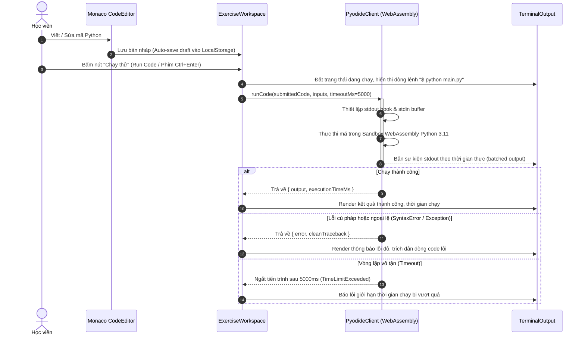
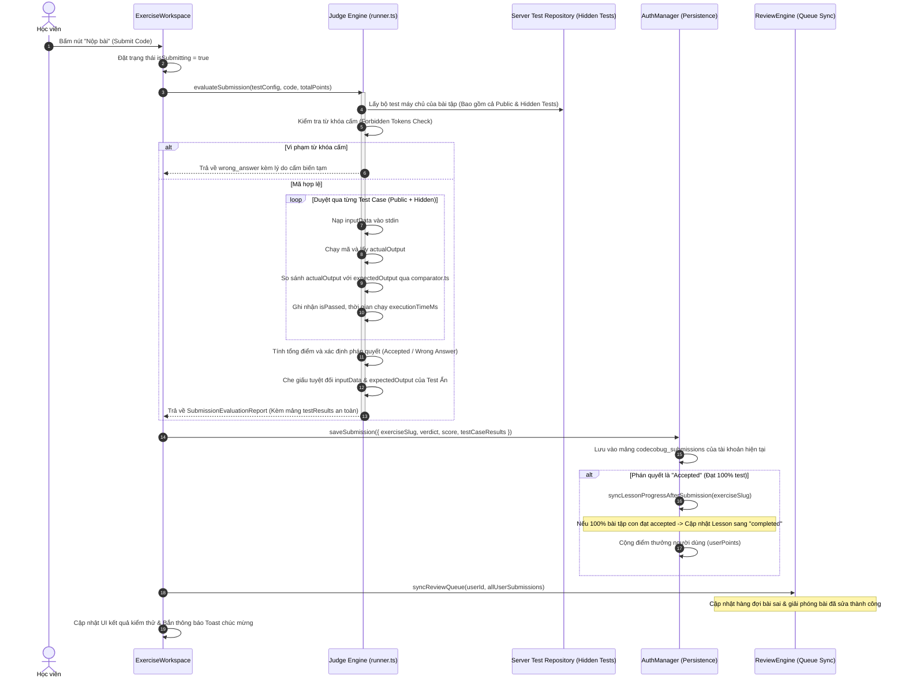
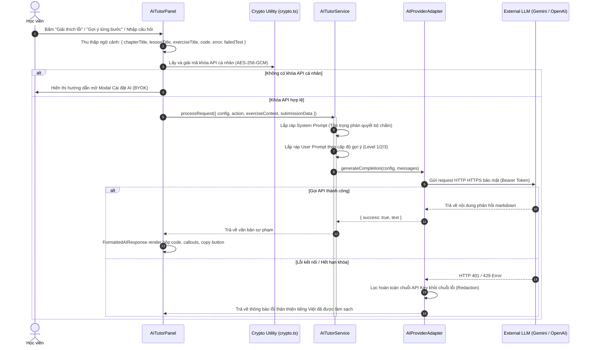
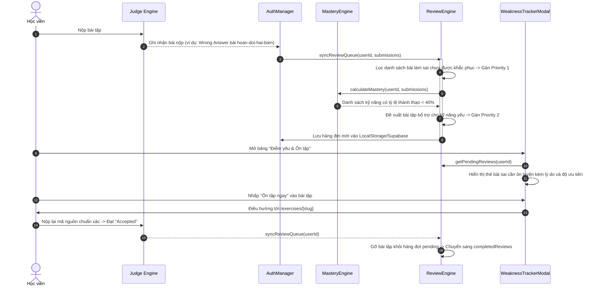

# CODECOBUG — DATA FLOW & SYSTEM INTERACTIONS
## (PHASE 1: COMPLETE PROJECT AUDIT)

**Tài liệu**: Bản đồ Luồng dữ liệu chi tiết giữa Frontend, Backend, WebAssembly Runtime và Database  
**Giai đoạn**: Phase 1 — Đọc và phân tích kiểm toán toàn diện (Read-Only Audit)  
**Mục tiêu bảo toàn**: Đảm bảo các luồng dữ liệu nghiệp vụ này được giữ nguyên 100% khi tái cấu trúc giao diện Pastel London.

---

## 1. Luồng 1: Chạy Thử Code Tại Chỗ (Run Code Flow)



---

## 2. Luồng 2: Nộp Bài & Chấm Điểm Tự Động (Submit Code Flow)



---

## 3. Luồng 3: Tương Tác với AI Gia Sư (AI Tutor Flow)



---

## 4. Luồng 4: Phân Tích Điểm Yếu & Ôn Tập Thích Ứng (Adaptive Review Flow)



---

## 5. Luồng 5: Bảo Vệ & Cách Ly Dữ Liệu Đa Người Dùng (Multi-Tenant Isolation Flow)

```
[Trình duyệt Người học]
      │
      ├── Đăng nhập Tài khoản Alice (ID: user-alice)
      │     └── Khóa lưu trữ: "codecobug_submissions_user-alice"
      │     └── Khóa tiến độ: "codecobug_lessons_progress_user-alice"
      │     └── Khóa điểm yếu: "codecobug_review_queue_user-alice"
      │
      ├── Đăng xuất Alice & Đăng nhập Tài khoản Bob (ID: user-bob)
      │     └── Khóa lưu trữ: "codecobug_submissions_user-bob"
      │     └── Khóa tiến độ: "codecobug_lessons_progress_user-bob"
      │     └── Khóa điểm yếu: "codecobug_review_queue_user-bob"
      │
      └── [Nguyên tắc Bảo mật]:
            - authManager tự động xóa sạch in-memory state khi signOut()
            - Mọi hàm truy xuất đều bắt buộc truyền userId làm partition key
            - Bob hoàn toàn không đọc hoặc ghi đè được dữ liệu của Alice
```

