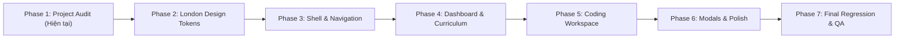

# CODECOBUG — PHASED IMPLEMENTATION PLAN: PASTEL LONDON REDESIGN
## (PHASE 1: COMPLETE PROJECT AUDIT)

**Tài liệu**: Kế hoạch triển khai có kiểm soát quá trình tái cấu trúc giao diện theo phong cách Pastel London  
**Giai đoạn**: Phase 1 — Đọc và phân tích kiểm toán toàn diện (Read-Only Audit)  
**Nguyên tắc tối thượng**: **Không làm hỏng tính năng đang hoạt động — Không thay đổi logic nghiệp vụ — Bảo toàn 100% kiểm thử**

---

## 1. Lộ trình Triển khai Tổng thể (Phased Roadmap)

---

## 2. Chi tiết Từng Giai đoạn Triển khai

### Giai đoạn 1: Kiểm toán Toàn diện & Lập Hồ sơ Kiến trúc (Phase 1 — Current)
- **Mục tiêu**: Đọc, phân tích, lập danh mục route, tính năng, luồng dữ liệu, đánh giá rủi ro và lập kế hoạch.
- **Ràng buộc**: **Chỉ đọc (Read-Only). Tuyệt đối không sửa mã nguồn ứng dụng.**
- **Kết quả đầu ra**: Thư mục `docs/project-audit/` với đầy đủ 7 tài liệu đặc tả.
- **Cổng chất lượng (Quality Gate)**: Xác nhận không có tệp mã nguồn nào bị sửa đổi (`git status` sạch đối với `src/`).

---

### Giai đoạn 2: Xây dựng Hệ thống Token Phong cách Pastel London (Phase 2 — Design System)
- **Mục tiêu**: Thiết lập bảng màu, kiểu chữ, khoảng cách, bo góc và đổ bóng mang phong cách Pastel London quý phái, thanh lịch, trang nhã.
- **Phạm vi công việc**:
  - Xây dựng bảng biến CSS tokens mới:
    - Sương mù London (`--london-fog`: `#F4F6F9`, Canvas nền mờ nhẹ)
    - Xanh pastel Regent (`--london-blue`: `#D2E3F8`, đại diện cho tri thức, quý phái)
    - Hồng phấn cổ điển (`--london-rose`: `#F9D8D6`, nét duyên dáng vintage Anh quốc)
    - Xanh lá công viên hoàng gia (`--london-sage`: `#CBE3D5`, thanh bình, dễ chịu)
    - Hổ phách trà chiều (`--london-tea`: `#FCE8C3`, ấm áp, cổ điển)
    - Màu chữ London Navy (`--text-london`: `#1E293B`, độ tương phản cao WCAG AAA)
  - Quy định độ bo góc: Điều chỉnh từ bo góc tròn lớn tuổi teen ($24\text{px}$) sang bo góc chuẩn quý phái, đĩnh đạc hơn ($12-16\text{px}$ cho card, $8-10\text{px}$ cho controls).
  - Tách token rõ ràng mà không xóa các biến cũ để đảm bảo tính tương thích ngược (Backward Compatibility).
- **Cổng chất lượng**: Chạy `npm run build` và `npm test` xác nhận không có lỗi cú pháp CSS.

---

### Giai đoạn 3: Tái cấu trúc Khung Ứng dụng & Thanh Điều hướng (Phase 3 — Shell & Nav)
- **Mục tiêu**: Nâng cấp `AppShell`, `Sidebar`, `Header`, và `MobileNav` sang phong cách Pastel London.
- **Phạm vi công việc**:
  - Thiết kế lại Sidebar với đường nét mảnh, logo phong cách London Studio sang trọng, icon tinh tế.
  - Header thanh thoát, tinh giản với thanh tra cứu và các huy hiệu trạng thái nhỏ gọn, không gây rối mắt.
  - MobileNav drawer với hiệu ứng mờ kính (Backdrop Blur) trang nhã.
- **Cổng chất lượng**: `tests/test_app_shell_and_nav.js` và `tests/test_responsive_and_accessibility.js` đạt 100% pass.

---

### Giai đoạn 4: Tái cấu trúc Bảng Điều khiển & Trình Duyệt Giáo trình (Phase 4 — Dashboard & Curriculum)
- **Mục tiêu**: Tái cấu trúc `LearningDashboard.tsx`, `CurriculumBrowser.tsx` và `LessonDetail.tsx`.
- **Phạm vi công việc**:
  - Hero container "Khu vực học tiếp" với layout trật tự, bảng màu kem trà chiều hoặc xanh Regent.
  - Thẻ chương học và bài học được thiết kế sắc nét, phân cấp thông tin rõ ràng.
  - Trang chi tiết bài học 10 phần hiển thị sang trọng, dễ đọc, khoảng cách dòng thoáng (Line-height 1.6), khối code hiển thị sắc nét.
- **Cổng chất lượng**: Chụp ảnh màn hình Desktop & Mobile kiểm tra bố cục; `tests/test_learning_dashboard.js` đạt 100% pass.

---

### Giai đoạn 5: Tối ưu Không gian Lập trình & Phòng Lab (Phase 5 — Workspace)
- **Mục tiêu**: Tinh chỉnh `ExerciseWorkspace`, `ProblemStatement`, `CodeEditor`, `TerminalOutput`.
- **Phạm vi công việc**:
  - Khung Monaco Editor viền xám sương mù thanh lịch, tab tệp tin bo nhẹ trang nhã.
  - Terminal dark slate sâu lắng, độ tương phản chữ cao, phông chữ JetBrains Mono.
  - Hộp đề bài rõ ràng, phân cách các trường hợp kiểm thử bằng thẻ viền mảnh.
  - Drawer AI Tutor trượt mượt mà với tông màu xanh Regent hoặc tím Lavender nhạt.
- **Cổng chất lượng**: `tests/test_exercise_workspace.js` và `tests/test_judge_engine.js` đạt 100% pass.

---

### Giai đoạn 6: Hoàn thiện Modals, Toasts & Tương tác Vi mô (Phase 6 — Modals & Polish)
- **Mục tiêu**: Cập nhật toàn bộ các cửa sổ Modal (`AuthModal`, `AISettingsModal`, `WeaknessTrackerModal`, `HelpModal`) và thông báo Toast.
- **Phạm vi công việc**:
  - Modal bo góc thanh lịch ($14-16\text{px}$), đổ bóng sâu sang trọng (`rgba(15, 23, 42, 0.12)`).
  - Bảng thống kê điểm yếu và lịch sử nộp bài hiển thị dạng bảng (Table) hoặc danh sách thẻ gọn gàng.
  - Hiệu ứng click nút (Button active state) nén nhẹ $0.98$ không giật layout shift.
- **Cổng chất lượng**: `tests/test_mastery_and_review.js` và `tests/test_ai_tutor_ui.js` đạt 100% pass.

---

### Giai đoạn 7: Kiểm thử Hồi quy Toàn diện & Dữ liệu Full-Stack (Phase 7 — Full-Stack Verification)
- **Mục tiêu**: Kiểm tra và hoàn thiện việc lưu trữ, truy xuất, đồng bộ dữ liệu người dùng và kết nối các chức năng học tập.
- **Phạm vi công việc**:
  - Xác thực mật mã HMAC Bearer Token cho toàn bộ phiên người dùng và backend API routes.
  - Đảm bảo bất biến tiến độ bài học (`not_started` -> `in_progress` -> `completed`), chống downgrade.
  - Phân tách rõ ràng giữa chạy thử Pyodide WebAssembly và nộp bài chính thức.
  - Đảm bảo tính toán trung thực trên Dashboard (Empty State, tính toán từ bài nộp `accepted`).
  - Hàng đợi ôn tập thích ứng (Spaced Repetition Review Queue) tự động kích hoạt khi có bài làm sai và tự động xóa khi giải đúng.
  - Cô lập dữ liệu đa người dùng (Strict Multi-tenant isolation) và chống nhân đôi điểm khi nộp lặp.
- **Cổng chất lượng**: `tests/test_phase7_full_stack_data_progress.js` (81/81 assertions passed).

---

### Giai đoạn 8: Kiểm thử Toàn diện, QA & Bàn giao Sản phẩm (Phase 8 — Full Regression, QA & Handover)
- **Mục tiêu**: Kiểm tra hồi quy toàn diện 100% chức năng, giao diện, bảo mật và nghiệp vụ của toàn bộ dự án CodeCoBUG.
- **Phạm vi công việc**:
  - Chạy `npm run type-check` (0 lỗi TypeScript, chế độ strict).
  - Chạy `npm run lint` (0 cảnh báo, 0 lỗi ESLint).
  - Chạy `npm test` (toàn bộ 34 bộ kiểm thử tự động với hàng nghìn assertions vượt qua 100%).
  - Chạy `tests/test_phase8_full_regression_and_handover.js` (123/123 assertions passed).
  - Chạy `npm run build` (sinh thành công 70/70 static pages trong 1.0 giây).
  - Chụp ảnh màn hình thực tế bằng Chrome Headless tại Desktop ($1440 \times 900$), Tablet ($768 \times 1024$), Mobile ($390 \times 844$).
  - Hoàn thiện bộ hồ sơ bàn giao: `docs/QA_REPORT.md`, `docs/KNOWN_ISSUES.md`, `docs/FEATURE_STATUS.md`, cập nhật `AGENT.md`.
- **Cổng chất lượng**: **ĐÃ NGHIỆM THU HOÀN THÀNH 100% — SẴN SÀNG BÀN GIAO.**

