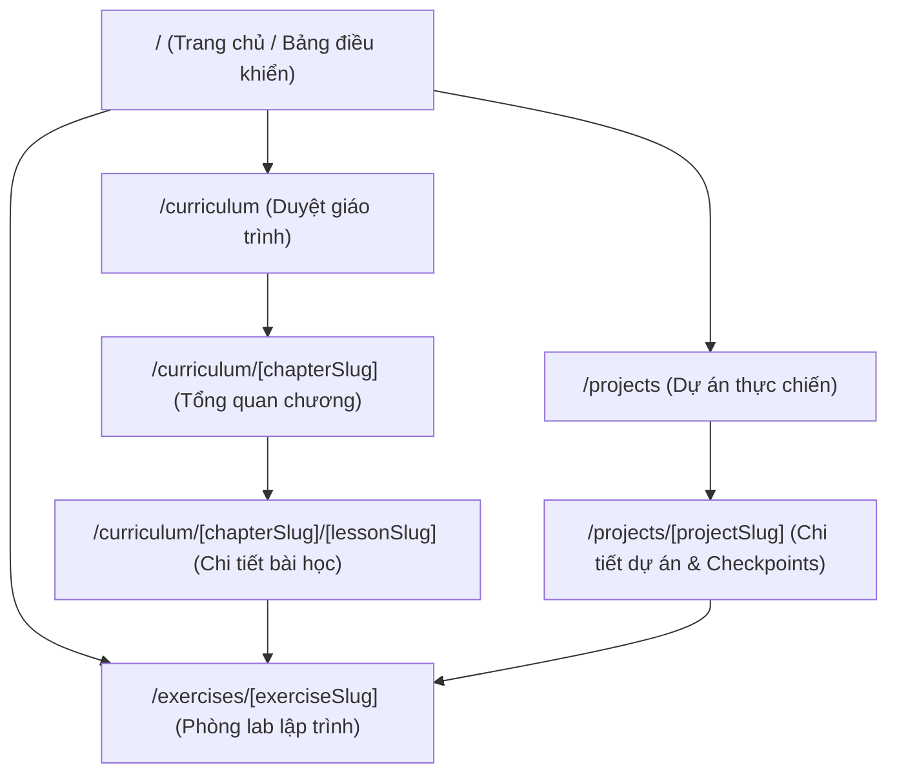

# CODECOBUG — ROUTE & INTERACTION CATALOG
## (PHASE 1: COMPLETE PROJECT AUDIT)

**Tài liệu**: Danh mục đầy đủ các tuyến đường (Routes), Trang (Pages), API và Điểm tương tác  
**Giai đoạn**: Phase 1 — Đọc và phân tích kiểm toán toàn diện (Read-Only Audit)  
**Tổng số tuyến đường web**: 70 Routes tĩnh được biên dịch (Static Pages) + 5 API Endpoints  
**Trạng thái mã nguồn**: **Đọc và đối chiếu thực tế — Không chỉnh sửa**

---

## 1. Bản đồ Tuyến đường Ứng dụng (Web Application Routes)

---

## 2. Chi tiết Danh mục Tuyến đường Giao diện (Frontend Pages)

### 2.1 `/` — Bảng Điều khiển Học tập (Learning Dashboard)
- **Tệp nguồn**: `src/app/page.tsx`
- **Thành phần chính**: `LearningDashboard` (`src/components/dashboard/LearningDashboard.tsx`)
- **Loại tuyến đường**: Static (○ Prerendered as static content)
- **Chức năng**:
  - Hero container hiển thị bài học/bài tập tiếp theo dựa trên tiến độ thực tế của học viên.
  - Thống kê tiến độ kép: `{completedLessonsCount}/{totalLessonsCount}` bài học và `{completedExercisesCount}/{totalExercisesCount}` bài tập.
  - Thanh năng lực học viên & tỷ lệ thành thạo kỹ năng tổng thể (Mastery score).
  - Thẻ tóm tắt "Bài tập gần đây" và "Đề xuất ôn tập thích ứng" (Adaptive Review).
  - Lưới duyệt nhanh 12 chương giáo trình và banner liên kết 3 dự án thực chiến (PBL).
- **Tương tác & Modal hỗ trợ**:
  - Mở `WeaknessTrackerModal` (xem kỹ năng, hàng đợi ôn tập, lịch sử nộp bài).
  - Mở `AuthModal` (đăng ký, đăng nhập tài khoản).
  - Mở `AISettingsModal` (cài đặt khóa API BYOK).
  - Mở `HelpModal` (hướng dẫn sử dụng & phím tắt).
  - Kích hoạt `AITutorModal` dạng pop-up trên desktop/mobile.

---

### 2.2 `/curriculum` — Trình Duyệt Giáo trình Tổng thể (Curriculum Browser)
- **Tệp nguồn**: `src/app/curriculum/page.tsx`
- **Thành phần chính**: `CurriculumBrowser` (`src/components/curriculum/CurriculumBrowser.tsx`)
- **Loại tuyến đường**: Static (○ Prerendered as static content)
- **Chức năng**:
  - Hiển thị danh mục toàn diện 12 chương giáo trình Python hợp nhất (Fundamentals).
  - Bộ lọc bài học theo cấp độ: Tất cả, Cơ bản (Beginner), Trung cấp (Intermediate), Nâng cao (Advanced).
  - Ô tìm kiếm bài học và kỹ năng theo từ khóa tức thì.
  - Thẻ từng chương hiển thị số bài học, số bài tập, thanh tiến độ riêng của chương và danh sách các bài học con.
  - Điều hướng tới trang chi tiết chương hoặc trang bài học cụ thể.

---

### 2.3 `/curriculum/[chapterSlug]` — Trang Tổng quan Chương học
- **Tệp nguồn**: `src/app/curriculum/[chapterSlug]/page.tsx`
- **Loại tuyến đường**: SSG (● Prerendered static HTML với `generateStaticParams`)
- **Số lượng tuyến đường sinh tĩnh**: **12 tuyến đường**
  - `/curriculum/chu-de-01-lam-quen-python`
  - `/curriculum/chu-de-02-bien-va-kieu-du-lieu`
  - `/curriculum/chu-de-03-so-hoc-va-toan-tu`
  - `/curriculum/chu-de-04-chuoi-ky-tu`
  - `/curriculum/chu-de-05-cau-truc-du-lieu`
  - `/curriculum/chu-de-06-cau-truc-dieu-kien`
  - `/curriculum/chu-de-07-vong-lap-python`
  - `/curriculum/chu-de-08-ham-functions`
  - `/curriculum/chu-de-09-ngoai-le-va-module`
  - `/curriculum/chu-de-10-thao-tac-file`
  - `/curriculum/chu-de-11-lap-trinh-oop`
  - `/curriculum/chu-de-12-python-nang-cao`
- **Chức năng**:
  - Breadcrumb điều hướng: `Trang chủ / Giáo trình / [Tên Chương]`.
  - Header chương học: Tiêu đề, tóm tắt lý thuyết, cấp độ, số lượng bài học, số lượng bài tập, tiến độ hoàn thành.
  - Danh sách tuần tự các bài học trong chương kèm huy hiệu trạng thái: `Chưa học`, `Đang học`, `Đã hoàn thành`.
  - Thẻ thông tin bài tập con tương ứng trong từng bài học và nút chuyển tiếp trực tiếp vào phòng lab.

---

### 2.4 `/curriculum/[chapterSlug]/[lessonSlug]` — Trang Chi tiết Bài học Chuẩn Sư phạm
- **Tệp nguồn**: `src/app/curriculum/[chapterSlug]/[lessonSlug]/page.tsx`
- **Thành phần chính**: `LessonDetail` (`src/components/curriculum/LessonDetail.tsx`)
- **Loại tuyến đường**: SSG (● Prerendered static HTML với `generateStaticParams`)
- **Số lượng tuyến đường sinh tĩnh**: **44 tuyến đường** (đầy đủ 44 bài học)
- **Chức năng**:
  - Bố cục sư phạm 10 phần hoàn chỉnh:
    1. Mục tiêu bài học cần đạt (`learningObjectives`)
    2. Điều kiện tiên quyết (`prerequisites`)
    3. Mô hình tư duy trực quan (`visualExplanation`)
    4. Lý thuyết nền tảng chuyên sâu (`theoryContent` render markdown)
    5. Ví dụ mã nguồn Python chạy thực tế (`codeExamples`) kèm output mẫu và nút "Sao chép mã"
    6. Phân tích chi tiết từng dòng code
    7. Lỗi thường gặp và cách khắc phục (`commonMistakes` với `{ mistake, explanation, fix }`)
    8. Nhiệm vụ hướng dẫn thực hành (`guidedPracticeTask`)
    9. Tóm tắt đọng lại (`recap`)
    10. Danh sách bài tập thực hành liên kết (`exercises`) dẫn thẳng vào không gian lập trình
  - Tự động cập nhật trạng thái bài học sang `in_progress` khi học viên truy cập đọc nội dung.

---

### 2.5 `/exercises/[exerciseSlug]` — Phòng Lab Lập trình Thực hành
- **Tệp nguồn**: `src/app/exercises/[exerciseSlug]/page.tsx`
- **Thành phần chính**: `ExerciseWorkspace` (`src/components/workspace/ExerciseWorkspace.tsx`)
- **Loại tuyến đường**: Dynamic Server-Rendered (ƒ)
- **Số lượng bài tập hỗ trợ**: **87 bài tập** (61 bài tập nền tảng + 26 bài tập chặng kiểm tra dự án)
- **Bố cục Không gian làm việc**:
  - **Cột trái (Problem & Theory Panel)**:
    - Tiêu đề, độ khó, điểm thưởng, tag kỹ năng.
    - Tab Đề bài: Mô tả yêu cầu, điều kiện hoàn thành, ví dụ I/O minh họa, gợi ý từng bước (Level 1, 2, 3).
    - Tab Lý thuyết bài học liên quan: Cho phép tra cứu nhanh kiến thức ngay trong lúc code.
  - **Cột phải (Coding & Execution Studio)**:
    - Monaco Editor (Python 3 syntax, autocomplete, theme pastel/dark, cỡ chữ tùy chỉnh, reset code, copy).
    - Thanh điều khiển: Nút "Chạy thử" (Run Code) và nút "Nộp bài" (Submit Code).
    - Terminal Output tương tác: Hiển thị dòng xuất `sys.stdout`, ô nhập `sys.stdin` cho hàm `input()`, thông báo lỗi compiler/runtime.
    - Tab "Kết quả kiểm thử": Chi tiết kết quả từng test case sau khi nộp bài.
    - Tab "Lịch sử": Xem lại toàn bộ các lần nộp bài trước đó kèm thời gian thực thi và chi tiết test case.
  - **Bảng điều khiển AI Tutor tích hợp (Collapsible Panel)**:
    - Nhận biết chính xác ngữ cảnh Chương học, Bài học, Bài tập hiện tại, mã nguồn đang viết và lỗi thực tế từ Judge Engine.
    - Các nút thao tác nhanh: "Giải thích lỗi", "Gợi ý từng bước", "Phân tích điểm yếu", "Đề xuất bài tập cùng chủ đề".

---

### 2.6 `/projects` — Danh mục Dự án Thực chiến (Project-Based Learning)
- **Tệp nguồn**: `src/app/projects/page.tsx`
- **Thành phần chính**: `ProjectList` (`src/components/projects/ProjectList.tsx`)
- **Loại tuyến đường**: Static (○ Prerendered as static content)
- **Chức năng**:
  - Giới thiệu 3 dự án Capstone chuyển giao từ Python Crash Course 3E.
  - Lưới hiển thị 3 dự án lớn:
    1. Alien Invasion (Pygame - 8 checkpoints)
    2. Data Visualization (Matplotlib, Plotly, CSV, APIs - 8 checkpoints)
    3. Web Applications (Django 4.1+ - 10 checkpoints)
  - Thông tin độ khó, công nghệ sử dụng, số lượng checkpoints và thanh tiến độ hoàn thành của từng dự án.

---

### 2.7 `/projects/[projectSlug]` — Trang Chi tiết Dự án & Chặng kiểm tra
- **Tệp nguồn**: `src/app/projects/[projectSlug]/page.tsx`
- **Thành phần chính**: `ProjectDetail` (`src/components/projects/ProjectDetail.tsx`)
- **Loại tuyến đường**: SSG (● Prerendered static HTML với `generateStaticParams`)
- **Số lượng tuyến đường sinh tĩnh**: **3 tuyến đường**
  - `/projects/du-an-01-alien-invasion`
  - `/projects/du-an-02-data-visualization`
  - `/projects/du-an-03-django-web-app`
- **Chức năng**:
  - Hướng dẫn tổng quan về dự án, kiến trúc mã nguồn và thư viện cần thiết.
  - Hướng dẫn cài đặt và chạy trên máy tính cá nhân (Local desktop instructions) với nút tải bundle mã nguồn mẫu.
  - Danh sách tuần tự các chặng kiểm tra (Checkpoints) với liên kết mở phòng lab kiểm thử in-browser cho từng checkpoint.

---

### 2.8 `/_not-found` — Trang Báo lỗi 404
- **Tệp nguồn**: `src/app/not-found.tsx`
- **Loại tuyến đường**: Static (○ Prerendered as static content)
- **Chức năng**:
  - Hiển thị thông báo trang hoặc bài tập không tồn tại theo chuẩn giao diện pastel.
  - Nút quay trở về Trang chủ an toàn.

---

## 3. Danh mục Tuyến đường API Backend (API Routes)

Tất cả các API endpoints đều nằm trong `src/app/api/` và được cấu hình phản hồi JSON chuẩn, kiểm soát CORS và xử lý lỗi nghiêm ngặt:

| Tuyến đường (Endpoint) | Phương thức | Tệp nguồn | Chức năng nghiệp vụ | Xác thực |
| :--- | :---: | :--- | :--- | :---: |
| `/api/judge/submit` | `POST` | `src/app/api/judge/submit/route.ts` | Tiếp nhận mã nguồn, nạp test cases máy chủ, chạy bộ chấm và trả về phán quyết (Accepted, Wrong Answer, Syntax Error, Timeout) | Guest / Token |
| `/api/ai/chat` | `POST` | `src/app/api/ai/chat/route.ts` | Gửi prompt có ngữ cảnh bài học tới LLM (Gemini hoặc OpenAI) bằng khóa BYOK được mã hóa | Token BYOK |
| `/api/ai/test-connection` | `POST` | `src/app/api/ai/test-connection/route.ts` | Kiểm tra tính hợp lệ và khả năng kết nối của khóa API trước khi lưu trữ | Token BYOK |
| `/api/submissions` | `GET`, `POST` | `src/app/api/submissions/route.ts` | Lưu trữ bài nộp lên Supabase hoặc truy xuất lịch sử làm bài theo tài khoản người dùng | Auth / Guest |
| `/api/review-queue` | `GET`, `POST` | `src/app/api/review-queue/route.ts` | Đồng bộ và truy xuất danh sách bài tập cần ôn tập dựa trên kết quả lỗi thực tế | Auth / Guest |

---

## 4. Danh mục Modals và Khung tương tác Toàn cục (Global Modals & Drawers)

Các thành phần tương tác này được điều khiển tập trung tại `AppShell` (`src/components/layout/AppShell.tsx`):

1. **`AuthModal` (`src/components/auth/AuthModal.tsx`)**:
   - Tab "Đăng nhập" (Sign In) và "Đăng ký" (Sign Up).
   - Đăng nhập bằng Email/Mật khẩu hoặc tiếp tục với chế độ Khách (Guest).
   - Nút liên kết mở cài đặt AI khi cần thiết.
2. **`AISettingsModal` (`src/components/settings/AISettingsModal.tsx`)**:
   - Chọn nhà cung cấp: Google Gemini (`gemini-2.0-flash`, `gemini-1.5-pro`) hoặc OpenAI (`gpt-4o`, `gpt-4o-mini`).
   - Nhập API Key với tính năng kiểm tra kết nối thời gian thực (`Kiểm tra kết nối`).
   - Tự động che mờ khóa hiển thị (`AIzaSy...stuv`) và lưu mã hóa AES-256-GCM.
3. **`WeaknessTrackerModal` (`src/components/mastery/WeaknessTrackerModal.tsx`)**:
   - Tab 1: **Kỹ năng (Skills)** — Danh sách cây kỹ năng và điểm năng lực tương ứng.
   - Tab 2: **Hàng đợi ôn tập (Queue)** — Danh sách bài sai cần ôn luyện theo độ ưu tiên 1 và 2.
   - Tab 3: **Chính sách (Policy)** — Giải thích nguyên lý thuật toán Lặp lại ngắt quãng (Spaced Repetition).
   - Tab 4: **Lịch sử nộp bài (History)** — Danh sách chi tiết toàn bộ các lần nộp bài thực tế kèm trạng thái và liên kết làm lại.
4. **`HelpModal` (`src/components/common/HelpModal.tsx`)**:
   - Bảng phím tắt bàn phím (Ctrl/Cmd + Enter để chạy code, Esc để đóng modal, ...).
   - Hướng dẫn các bước học tập và sử dụng AI Tutor.
5. **`MobileNav` (`src/components/layout/MobileNav.tsx`)**:
   - Drawer trượt từ bên trái màn hình cho thiết bị di động ($< 1024\text{px}$).
   - Menu điều hướng 3 điểm đến, truy cập nhanh cài đặt, đăng nhập và bảng điểm yếu.

