# CodeCoBUG UI Dependency Map

> **Bản đồ phụ thuộc giao diện:** Biểu diễn trực quan mối liên kết giữa Routes, Layouts, Components, State Management và Utilities trong hệ thống CodeCoBUG.

---

## 1. Sơ Đồ Kiến Trúc Phân Tầng Giao Diện (Mermaid Architecture)

```mermaid
graph TD
    subgraph Routes ["Pages & Routing Layer (App Router)"]
        R_Home["/ (Home Page)"]
        R_Curriculum["/curriculum (Curriculum Page)"]
        R_Workspace["/exercises/[exerciseSlug] (Workspace Page)"]
        R_404["not-found.tsx (404 Page)"]
    end

    subgraph Layouts ["Layout & Shell Layer"]
        L_Root["RootLayout (src/app/layout.tsx)"]
        L_AppShell["AppShell (src/components/layout/AppShell.tsx)"]
        C_Sidebar["Sidebar (Desktop Nav)"]
        C_MobileNav["MobileNav (Mobile Bottom Nav)"]
    end

    subgraph Views ["Page View Components"]
        V_Dashboard["LearningDashboard"]
        V_Browser["CurriculumBrowser"]
        V_Workspace["ExerciseWorkspace"]
    end

    subgraph WorkspaceCore ["Workspace Core Sub-systems"]
        W_Problem["ProblemStatement"]
        W_Editor["CodeEditor (Monaco)"]
        W_Terminal["TerminalOutput"]
        W_AITutor["AITutorPanel"]
    end

    subgraph Modals ["Global Modals Layer"]
        M_Auth["AuthModal"]
        M_Settings["AISettingsModal"]
        M_Help["HelpModal"]
        M_Weakness["WeaknessTrackerModal"]
        M_AIFull["AITutorModal"]
    end

    subgraph Primitives ["Shared UI Primitives"]
        P_Button["Button"]
        P_Card["Card"]
        P_Badge["Badge"]
        P_Modal["Modal"]
        P_Input["Input"]
        P_Textarea["Textarea"]
        P_Tabs["Tabs"]
        P_Toast["Toast"]
    end

    subgraph DataAndEngines ["Data & Engine Services"]
        E_Pyodide["usePyodide / PyodideClient (WebAssembly)"]
        E_Curriculum["curriculumRegistry (120 Lessons)"]
        E_Submission["submissionStore (Test Runner / LocalStorage)"]
        E_AIAdapter["AIProviderAdapter (Gemini / OpenAI / Anthropic)"]
        E_Mastery["masteryEngine & reviewEngine"]
    end

    %% Mối quan hệ Layouts
    L_Root --> R_Home
    L_Root --> R_Curriculum
    L_Root --> R_Workspace
    L_Root --> R_404

    R_Home --> L_AppShell
    R_Curriculum --> L_AppShell

    L_AppShell --> C_Sidebar
    L_AppShell --> C_MobileNav
    L_AppShell --> V_Dashboard
    L_AppShell --> V_Browser

    %% Workspace độc lập
    R_Workspace --> V_Workspace
    V_Workspace --> W_Problem
    V_Workspace --> W_Editor
    V_Workspace --> W_Terminal
    V_Workspace --> W_AITutor

    %% Modals kết nối
    L_AppShell --> M_Auth
    L_AppShell --> M_Settings
    L_AppShell --> M_Help
    L_AppShell --> M_Weakness
    V_Workspace --> M_Settings
    V_Workspace --> M_Help
    V_Workspace --> M_AIFull

    %% Sử dụng UI Primitives
    V_Dashboard --> P_Card
    V_Dashboard --> P_Badge
    V_Dashboard --> P_Button

    V_Browser --> P_Card
    V_Browser --> P_Badge
    V_Browser --> P_Button
    V_Browser --> P_Input

    W_Problem --> P_Card
    W_Problem --> P_Badge
    W_Problem --> P_Button

    W_Terminal --> P_Tabs
    W_Terminal --> P_Badge
    W_Terminal --> P_Button

    W_AITutor --> P_Card
    W_AITutor --> P_Badge
    W_AITutor --> P_Button
    W_AITutor --> P_Textarea

    M_Auth --> P_Modal
    M_Settings --> P_Modal
    M_Help --> P_Modal
    M_Weakness --> P_Modal
    M_AIFull --> P_Modal

    %% Kết nối Data & Engines
    V_Dashboard --> E_Curriculum
    V_Dashboard --> E_Submission
    V_Browser --> E_Curriculum

    V_Workspace --> E_Curriculum
    V_Workspace --> E_Pyodide
    V_Workspace --> E_Submission

    W_AITutor --> E_AIAdapter
    M_Weakness --> E_Mastery
```

---

## 2. Bảng Phân Tích Luồng Dữ Liệu UI (Data Flow)

1. **Luồng Khởi Động & Nạp Khung Sườn (Bootstrap Flow):**  
   `src/app/layout.tsx` -> nhúng `src/app/globals.css` -> khởi tạo font, biến màu pastel `:root` và layout tổng thể.
2. **Luồng Điều Hướng Ứng Dụng (Navigation Flow):**  
   `Sidebar` / `MobileNav` lắng nghe URL hiện tại thông qua `next/navigation` (`usePathname()`) để kích hoạt trạng thái `active` trên các thẻ menu tương ứng.
3. **Luồng Thực Thi & Chấm Bài Tập (Execution Flow):**  
   `CodeEditor` gửi source code tới hook `usePyodide()` -> Pyodide thực thi code WebAssembly trong Browser thread -> kết quả đầu ra được gửi tới `TerminalOutput` và hệ thống chấm `submissionStore` để cập nhật trạng thái Pass/Fail cho Test Cases.
4. **Luồng Gia Sư AI Socratic (AI Tutor Flow):**  
   `AITutorPanel` lấy mã nguồn hiện tại trong `CodeEditor` + dữ liệu bài tập trong `ProblemStatement` -> đóng gói payload và gửi tới API backend `/api/ai/chat` -> nhận phản hồi và render qua `FormattedAIResponse`.

